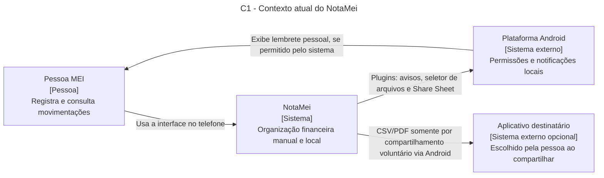
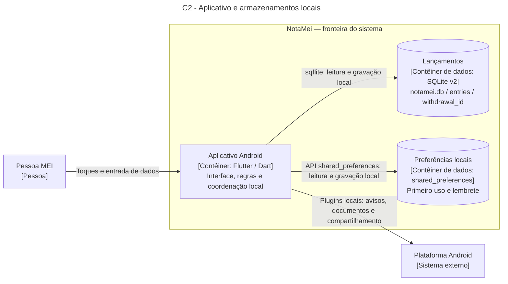
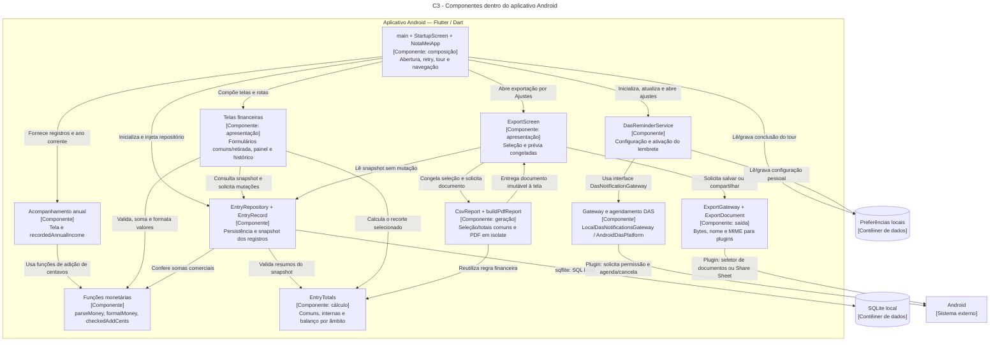
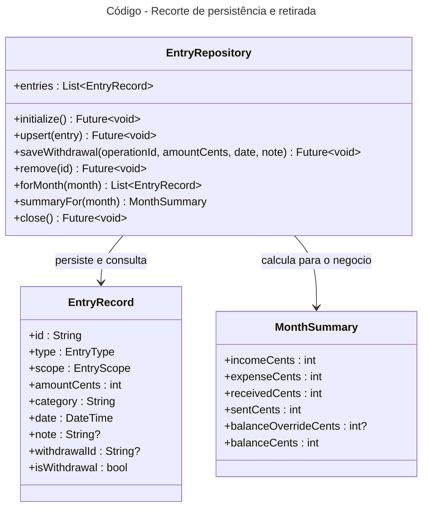
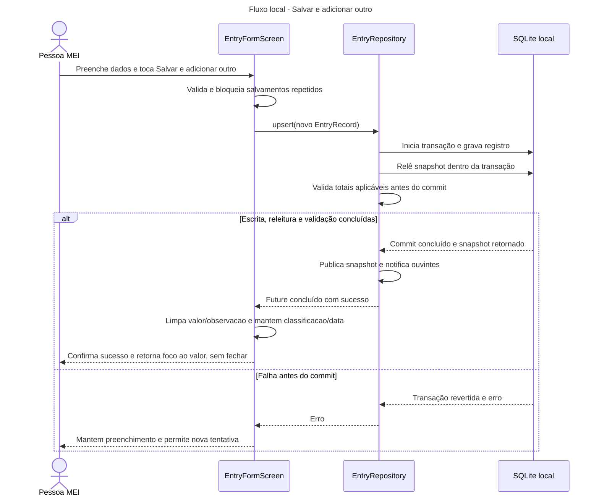
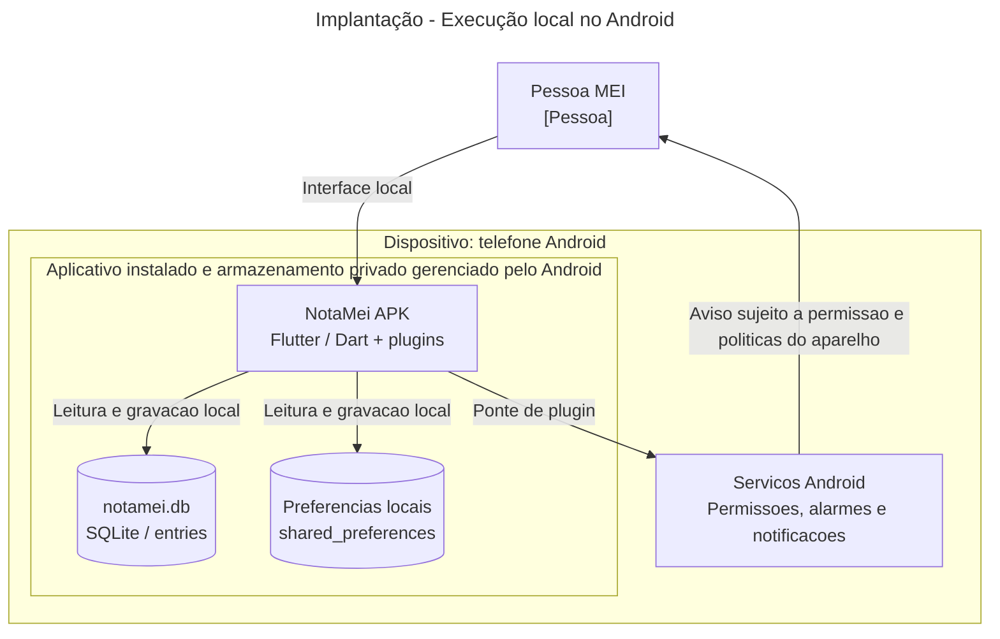

# NotaMei — documentação de arquitetura C4

**Revisão:** 11 de novembro de 2026. **Base de código inspecionada:** `9076f3d`.

**Escopo observado:** MVP Android local, incluindo FB01/FB02, FB04/FB05 e FB08. Revisão documental na branch `docs/requisitos-rastreabilidade`, sem mudança do aplicativo. O código é a fonte de verdade; referências a branches e contagens anteriores são históricas. Os seis diagramas desta edição e o HTML derivado foram alinhados ao recorte observado, não a um servidor fictício.

> **Complemento da evolução CSV:** FB04 está implementado em `lib/export/`: Ajustes abre a seleção, `CsvReport` filtra um snapshot sem mutações e `ExportGateway` entrega o arquivo ao seletor de documentos ou ao compartilhamento Android. Arquivos exportados e aplicativos destinatários ampliam a fronteira de dados; não há backend novo. O recorte histórico da implementação CSV e suas contagens antigas estão em [exportação CSV, validação e rollback](../hermes/EXPORTACAO-CSV.md).

> **Complemento PDF (FB05):** Ajustes também abre PDF. `buildPdfReport` renderiza em isolate o mesmo snapshot/totais de `CsvReport`, com Inter e marca locais; `ExportDocument` transporta bytes imutáveis, nome e MIME para `ExportGateway.saveDocument/shareDocument`. Não há servidor, migração ou escrita financeira novos. A arquitetura atual resumida está em [requisitos e arquitetura](../hermes/REQUISITOS-ARQUITETURA.md#4-arquitetura-implementada); limites e contagens históricas estão em [EXPORTACAO-PDF.md](../hermes/EXPORTACAO-PDF.md).

**Público:** equipe de desenvolvimento, orientação acadêmica e colaboradores.
**Visualização:** [diagramas em HTML autossuficiente](c4-notamei.html), sem dependências de rede. Este Markdown é a fonte principal; o HTML é uma representação derivada dos diagramas.

> Esta documentação distingue **implementação observada**, **expectativas acadêmicas** e **propostas futuras**. Não afirma conformidade fiscal, impacto social medido ou atendimento integral das disciplinas. Os documentos originais e as respostas individuais permanecem locais e ignorados pelo Git.

## 1. Fontes, limites e forma de leitura

### 1.1. Registro de fontes locais

Os identificadores abaixo permitem conferir a origem das interpretações. Os anexos privados não são necessários para compilar ou executar o aplicativo e não são distribuídos com esta documentação.

| ID | Fonte consultada | Trechos relevantes / uso |
| --- | --- | --- |
| DOC-EXT | `Plano_de_Ensino_Projeto_Extensionista_iv_ADS.pdf` | Seções 2–4 e 7–11: aplicação de integração/IA a problema real, extensão, entregáveis, avaliação e participação da comunidade. |
| DOC-INT | `Plano_de_Ensino_Projeto_Integrador_ADS.pdf` | Seções 2–4 e 7–11: mobile, boas práticas, evidências de IA e API, entrega/testes e defesa do projeto. |
| DOC-REL | `ControleMEI_Atividade_Pratica_Extensionista_Scrum.pdf` | Introdução, Objetivos, Fundamentação Teórica, Metodologia e Desenvolvimento, Resultados e Discussão, Considerações Finais: proposta inicial, levantamento, MVP e processo Scrum. |
| PESQ | Formulário exploratório local com respostas reais de MEIs | Somente síntese temática, sem respostas individuais, cruzamentos por participante, contatos, perfis, transcrições ou contagens. |
| REQ | [Requisitos e arquitetura compartilháveis](../hermes/REQUISITOS-ARQUITETURA.md) | RF01–RF10, FB01–FB07, decisões e limites de validação. |
| COD | Código e testes do repositório | Caminhos específicos nas tabelas e diagramas seguintes. Define o que existe na versão examinada. |

**Regra de precedência:** planos de ensino indicam expectativas acadêmicas; relatório e formulário contextualizam o problema; requisitos registram decisões de produto; código determina a arquitetura implementada. Uma intenção descrita em PDF não é prova de implementação ou de resultado.

O relatório usa o nome inicial **ControleMEI**; o aplicativo e o repositório atuais usam **NotaMei**. Este documento relaciona os materiais pelo contexto fornecido pelo responsável, sem presumir que o relatório descreva exatamente a versão atual. Afirmações históricas de entrevistas, testes, benefícios ou validação presentes no relatório não são reclassificadas como evidências desta versão. [DOC-REL; COD]

### 1.2. Limitação da pesquisa

A coleta é exploratória, com poucas respostas, seleção não representativa e sem desenho de avaliação de impacto. Serve para formular hipóteses e orientar próximos testes; não permite estimar preferências da população de MEIs, estabelecer causalidade ou declarar que o produto resolveu o problema. Não publicamos percentuais, rankings ou combinações que possam individualizar participantes. [PESQ]

Os temas observados incluem diversidade de formas de registro, dificuldade em distinguir recursos pessoais e comerciais, interesse em registro rápido, lembrança do DAS e acompanhamento do que foi registrado. São **insumos qualitativos**, não requisitos automaticamente aprovados. Preferências por computador também aparecem na coleta: o foco Android é uma decisão do MVP, não uma preferência universal demonstrada. [PESQ; REQ]

### 1.3. Convenções C4

O C4 organiza a estrutura estática em Contexto, Contêineres, Componentes e Código; diagramas dinâmicos e de implantação complementam essas vistas. Nem todo projeto precisa dos quatro níveis, mas incluímos aqui um recorte pequeno de código útil para entender a persistência.[1]

Os blocos Mermaid usam tipos explícitos, fronteiras e relações nomeadas. São uma representação **no estilo C4**, não uma especificação formal validada por ferramenta C4. Em C4, contêiner significa aplicação ou armazenamento de dados, não necessariamente Docker ou processo independente.[2]

**Legenda:** `[Pessoa]` = usuário; `[Sistema externo]` = plataforma/aplicativo fora da fronteira do NotaMei; `[Sistema]` = produto; `[Contêiner]` = aplicação/armazenamento; `[Componente]` = responsabilidade dentro do app. Setas nomeiam chamadas locais, SQL ou ponte de plugin, não HTTP. C1 não expõe o banco; C2 contém app e armazenamentos locais; C3 expande somente o aplicativo. A vista de código é seletiva; sequência e implantação complementam as vistas estáticas. A seção 10 registra decisões observadas; propostas futuras ficam na seção 11.

**Rastreabilidade e decisões:** [matriz de requisitos, feedbacks e evidências](RASTREABILIDADE.md) e [ADRs retrospectivos](decisoes/README.md). Metas de RNF não são resultados medidos; registrar arquitetura existente não ratifica retroativamente decisões da equipe. Não se aplica aqui a obrigação de cliente-servidor, endpoints HTTP ou dois serviços externos de outro exercício acadêmico.

## 2. Direcionadores e aderência acadêmica

### 2.1. Problema e objetivo

Apoiar o registro manual de entradas e saídas e a consulta de movimentações, distinguindo Negócio e Pessoal. O balanço é a diferença aritmética entre registros informados: não é lucro contábil nem saldo bancário. O acompanhamento anual soma apenas entradas comerciais registradas, sem certificar faturamento fiscal ou limite legal. [DOC-REL; REQ; COD: `lib/annual/annual_summary.dart`]

| Direcionador | Consequência arquitetural atual ou pendente |
| --- | --- |
| Registro simples, com pouco esforço [PESQ; REQ: FB01] | Formulário manual; salvar e adicionar outro mantém classificação/data e só limpa valor/observação após persistência. |
| Distinguir âmbitos [PESQ; REQ: RF02, FB02] | `EntryScope`; filtro explícito Negócio/Pessoal/Todos; anual somente comercial. Não há classificação automática nem separação de contas bancárias. |
| Acesso local sem conta no produto [REQ] | Flutter com SQLite e preferências locais; cadastro/consulta não dependem de backend. |
| Confiabilidade dos valores [COD] | Centavos inteiros, validação e adição verificada; falhas não devem produzir confirmação de sucesso. |
| Lembrete configurável [PESQ; REQ: RF06] | Serviço e gateway locais com permissão Android; não há consulta, emissão ou pagamento de DAS. |
| Mobile, qualidade e entregáveis [DOC-INT; DOC-EXT] | Código, testes e documentação existentes; avaliação acadêmica e evidências de comunidade devem ser reunidas separadamente. |
| IA e API [DOC-INT; DOC-EXT] | **Lacuna atual:** não há IA no app nem integração funcional com API externa. Necessita escopo, arquitetura e validação próprios. |

### 2.2. Expectativa não equivale a entrega

| Eixo dos PDFs | Situação documentada e evidência que falta |
| --- | --- |
| Problema real e contextualização | Relatório e coleta exploratória contextualizam o tema. Faltam novos testes observados e critérios prévios para demonstrar utilidade. |
| Participação e devolutiva à comunidade | Aplicação real, feedback, acessibilidade e devolutiva precisam de evidências adequadas e consentidas. A existência do APK não prova impacto. |
| IA no aplicativo | Não implementada. Ferramentas de IA usadas no desenvolvimento não equivalem a uma funcionalidade de IA entregue ao usuário. |
| Integração via API | SQLite, interfaces Dart e pontes de plugin não são apresentados aqui como atendimento à expectativa curricular de integração com serviço externo. O escopo exigido deve ser confirmado com a orientação. |
| Scrum e acompanhamento | O relatório propõe Scrum; esta documentação não comprova papéis, cerimônias ou execução de sprints que não foram auditados. |
| Qualidade e testes | Há testes automatizados e validação técnica registrada em REQ §6.7. Isso não substitui avaliação de usabilidade, efeitos na comunidade ou entrega futura de notificações. |
| Entregáveis acadêmicos | Diagramas, código e APK podem compor a entrega; relatórios, apresentação, participação e critérios da disciplina exigem conferência própria. |

## 3. C1 — contexto do sistema atual

**Escopo:** NotaMei como sistema único. **Público:** pessoas envolvidas no produto e na orientação acadêmica.

A equipe acadêmica orienta, desenvolve e observa demonstrações com consentimento, mas não é um usuário administrador com acesso remoto aos lançamentos. Não há papel de contador, painel de gestão, login ou serviço receptor dos dados. Canais oficiais para conferir o DAS ficam fora da integração: a pessoa os consulta por conta própria. [REQ; COD: `lib/app/notamei_app.dart`, `lib/das/local_das_gateway.dart`]

GitHub, Flutter SDK, Android SDK, Hermes, OpenCode e Stitch pertencem ao desenvolvimento/referência visual; não são dependências de execução do núcleo financeiro instalado.

## 4. C2 — contêineres atuais

**Escopo:** fronteira do NotaMei. Os dois armazenamentos são locais ao aplicativo, não servidores separados.[2]

| Elemento | Responsabilidade | Tecnologia / persistência |
| --- | --- | --- |
| Aplicativo | Tour, navegação, formulário, painel, histórico, anual e lembretes | Flutter/Dart em um aplicativo Android; componentes não são serviços distribuídos. |
| Lançamentos | Armazenar registros e retiradas vinculadas | `sqflite`, SQLite, esquema versão 2; migração aditiva de v1 e snapshot publicado após commit. |
| Preferências | Guardar conclusão do tour e configuração do lembrete | `shared_preferences`; não guarda o livro de lançamentos. |
| Plataforma Android | Permissões, agendamento e apresentação de avisos | `flutter_local_notifications`, `timezone` e `flutter_timezone`; dependência do comportamento do aparelho. |

Rastreio: [`lib/main.dart`](../../lib/main.dart), [`lib/data/entry_repository.dart`](../../lib/data/entry_repository.dart), [`lib/das/das_reminder_service.dart`](../../lib/das/das_reminder_service.dart), [`lib/das/local_das_gateway.dart`](../../lib/das/local_das_gateway.dart) e [`pubspec.yaml`](../../pubspec.yaml).

Não há HTTP de negócio, banco remoto, backend, autenticação, sincronização, mensageria, telemetria própria ou modelo de IA nesta arquitetura. A ausência de integração própria não é garantia sobre backup ou comportamento do sistema operacional. [REQ; COD]

## 5. C3 — componentes do aplicativo

**Escopo:** contêiner Aplicativo Android. Os grupos abaixo organizam responsabilidades reais; não representam uma implementação formal de Clean Architecture.

| Componente / fontes | Responsabilidade e limite |
| --- | --- |
| [`main`](../../lib/main.dart), [`StartupScreen`](../../lib/app/startup_screen.dart), [`NotaMeiApp`](../../lib/app/notamei_app.dart), [`onboarding/`](../../lib/onboarding/) | Inicialização/composição por construtores; retry de abertura sem limpeza automática; falha de refresh DAS não bloqueia a abertura financeira. `IndexedStack` conserva abas. |
| [`EntryFormScreen`](../../lib/finance/entry_form_screen.dart) | Cria/edita/exclui com o repositório. FB01 é adicional ao salvamento normal; na sequência, só limpa valor/observação após sucesso. Edição não oferece sequência. |
| [`DashboardScreen`](../../lib/finance/dashboard_screen.dart), [`EntryHistoryScreen`](../../lib/finance/entry_history_screen.dart) | Consultas e filtros locais. No Início, Negócio/Pessoal/Todos filtra totais, recentes e vazio. A seleção vive no estado da tela, não em preferências persistidas. |
| [`EntryRepository`](../../lib/data/entry_repository.dart), [`EntryRecord`](../../lib/data/entry_record.dart) | Banco, snapshot imutável e notificação de ouvintes; mutações serializadas por fila de futures. Telas dependem diretamente do repositório. |
| [`money.dart`](../../lib/core/money.dart) | Conversão, formatação e soma segura de centavos. O projeto não delega cálculos monetários a texto de IA. |
| [`annual/`](../../lib/annual/) | `recordedAnnualIncome` recebe registros e ano; não consulta banco ou API. A composição atual passa os registros do repositório e o ano corrente. |
| [`DasReminderService`](../../lib/das/das_reminder_service.dart) | Valida configuração, pede permissão via gateway e guarda preferências após agendar; desativação cancela os avisos próprios. |
| [`local_das_gateway.dart`](../../lib/das/local_das_gateway.dart), [`das_schedule.dart`](../../lib/das/das_schedule.dart) | Cálculo de datas, janela móvel de 12 avisos, adaptação ao fuso e ponte Android; agendamento aproximado, sem calendário fiscal automático. |
| [`EntryTotals`](../../lib/data/entry_totals.dart) | Regra compartilhada de totais externos/internos por âmbito; acumuladores exatos, sem interpretar balanço como saldo bancário. |
| [`ExportScreen`](../../lib/export/export_screen.dart), [`CsvReport`](../../lib/export/csv_export.dart), [`buildPdfReport`](../../lib/export/pdf_export.dart) | Seleção/prévia e geração local; PDF reutiliza o relatório e renderiza em isolate, sem segunda regra financeira. |
| [`ExportGateway`](../../lib/export/export_gateway.dart), [`ExportDocument`](../../lib/export/export_document.dart) | Saída voluntária de bytes, nome e MIME; nativo controla seletor/compartilhamento, sem comprovar entrega final. |

**Estado da separação de responsabilidades:** existe separação por arquivos e domínio, mas não uma camada independente de casos de uso. O painel calcula totais do filtro sobre `forMonth`; `summaryFor` no repositório permanece comercial. A soma anual recebe registros; não precisa depender do repositório diretamente. [COD]

## 6. C4 — recorte de código: persistência de lançamentos

**Escopo:** persistência e seus objetos de dados em `lib/data/`. Recorte manual de classes e membros relevantes, não catálogo completo. O nível de código é opcional e deve ser atualizado quando essas estruturas mudarem.[3]

`note` e `withdrawalId` são anuláveis (`String?`); `balanceCents` é um getter calculado. `EntryType` admite `income`/`expense`; `EntryScope` admite `business`/`personal`. O esquema SQLite atual é **versão 2**: a tabela `entries` inclui `withdrawal_id TEXT` além de `id`, `type`, `scope`, `amount_cents`, `category`, `date` e `note`. Na abertura de uma base v1, `onUpgrade` faz apenas `ALTER TABLE ... ADD COLUMN withdrawal_id TEXT`; os registros antigos permanecem com vínculo nulo e as preferências não são alteradas. Não há downgrade de dados nem inferência de vínculo por categoria, valor, data ou nota. A data é persistida em texto ISO; mês e ano respeitam a data registrada, sem conversão de fuso na consulta mensal. [COD: `lib/data/entry_record.dart`, `lib/data/entry_repository.dart`; teste histórico em `test/data/withdrawal_test.dart`]

### 6.1. Invariantes e limites

- Valor de cada lançamento é positivo e expresso em centavos inteiros; o tipo diferencia entrada e saída.
- Identificador e categoria não podem estar vazios; o banco também restringe tipos e âmbitos.
- `upsert`, `remove` e `saveWithdrawal` passam pela fila `_enqueue` e usam transações SQLite. As validações de domínio e colisão ocorrem antes ou durante a operação; a alteração e a leitura do novo snapshot ocorrem dentro da transação. O estado em memória e a notificação dos ouvintes só mudam depois do commit bem-sucedido. A fila serializa mutações neste repositório; isso não constitui transação distribuída nem política de sincronização.
- `saveWithdrawal` valida identificador não vazio e valor positivo e registra duas movimentações vinculadas por `withdrawal_id`: uma despesa no âmbito Negócio e uma entrada no âmbito Pessoal. Ambas pertencem à mesma transação; falha na segunda ponta, na releitura ou nos totais faz a transação falhar sem publicar uma ponta isolada. Retry da mesma operação atualiza as duas linhas determinísticas sem duplicá-las; colisão com registro comum é recusada.
- A exclusão de um lançamento vinculado a uma retirada remove as duas linhas que compartilham o mesmo `withdrawal_id`, na mesma transação. O `upsert` comum recusa alterar uma ponta vinculada; a remoção e edição da retirada usam o fluxo próprio.
- `EntryTotals` separa entradas e despesas comuns (`incomeCents` e `expenseCents`) das movimentações internas (`receivedCents` e `sentCents`).
- Nos âmbitos Negócio e Pessoal, o saldo considera entradas menos despesas, mais valores recebidos e menos valores enviados por retiradas.
- Na visão consolidada (Todos), as movimentações internas não alteram o saldo: o cálculo considera apenas entradas e despesas comuns.
- Os totais são acumulados com `BigInt` e validados contra `maxMoneyCents` antes da conversão para `int`, evitando apresentar resultados fora do intervalo monetário suportado.
- O repositório grava, relê o snapshot e só então notifica ouvintes. Não se promete recuperação automática de qualquer falha de disco ou interrupção de processo.
- Somas usam `checkedAddCents`; o painel também captura estouro no conjunto selecionado e não mostra total parcial como válido.
- Negócio/Pessoal é classificação manual, não duas contas bancárias. Total geral não deve ser chamado de faturamento comercial; anual exclui despesas e registros pessoais.

O código observado executa essas mutações em transações, valida os totais antes de publicar o snapshot e notifica somente após a conclusão bem-sucedida. A cobertura documentada historicamente inclui cenários de retirada e falhas simuladas, mas nenhum teste foi executado nesta T04; isso também não garante recuperação após qualquer falha física do dispositivo ou interrupção do processo. [COD: `test/data/withdrawal_test.dart`; histórico em REQ §6.7]

Rastreio: [`entry_record.dart`](../../lib/data/entry_record.dart), [`entry_repository.dart`](../../lib/data/entry_repository.dart), [`money.dart`](../../lib/core/money.dart), [`dashboard_screen.dart`](../../lib/finance/dashboard_screen.dart).

## 7. Vista dinâmica — salvar e adicionar outro (FB01)

**Escopo:** criação de um novo lançamento; respostas de erro são separadas do caminho de sucesso.

O salvamento normal fecha o formulário após sucesso por `onSaved`; a sequência permanece na tela e cada novo cadastro usa outro identificador. A edição mantém o identificador do registro existente. Campos textuais, novos salvamentos e retorno ficam bloqueados durante a gravação; isso **não** afirma que todos os seletores da interface sejam desativados nessa versão. [COD: `lib/finance/entry_form_screen.dart`; REQ: §6.1]

**Fronteira de falha:** na base inspecionada, `upsert` grava e relê o snapshot dentro da transação; uma falha nessa releitura não deve ser descrita como escrita já confirmada fora da transação. Após o commit, outras falhas de interface/processo ainda podem existir: erro genérico não prova ausência de persistência em qualquer cenário. Esta revisão conferiu o caminho estático, sem executar novos testes de interrupção ou recuperação.

## 8. Vista de implantação — execução local

**Escopo:** aparelho Android com APK instalado. É uma vista lógica de implantação, não garantia de isolamento contra qualquer acesso físico ou comportamento do sistema.

- O computador e o ADB servem para construir/instalar/depurar, não são necessários para o uso normal depois da instalação. Não há servidor a iniciar para cadastrar ou consultar. [REQ; COD]
- A limpeza de dados ou desinstalação pode remover o histórico local. O aplicativo possui funcionalidades de exportação CSV e PDF, mas os arquivos gerados não constituem um mecanismo de restauração do banco SQLite. O backup do sistema operacional não foi validado como garantia de recuperação dos dados. [REQ]
- Há permissão de notificação e receptores para eventos como reinício/atualização no manifest; isso não comprova entrega futura, pontualidade ou comportamento em todos os aparelhos. [COD: `android/app/src/main/AndroidManifest.xml`]
- A configuração `release` ainda usa assinatura de depuração. Antes de distribuição pública, preparar assinatura, atualização, preservação de dados e validações adicionais. [COD: `android/app/build.gradle.kts`]

## 9. Arquitetura atual de exportação CSV/PDF

FB04 e FB05 compartilham a seleção de `ExportSelection` e o relatório imutável `CsvReport`. A tela escolhe data civil de referência, dia/semana/mês/ano, âmbito (Negócio/Pessoal/Todos), tipo e observações opt-in. O relatório filtra o snapshot do repositório, calcula `EntryTotals` sobre as linhas selecionadas e expõe prévia e arquivo com os mesmos critérios. `Todos` não incorpora pontas internas ao balanço ou aos totais externos, mesmo com filtro de tipo; em âmbito individual, recebidas/enviadas afetam o balanço.

Para CSV, `CsvReport` produz UTF-8 com BOM, delimitador `;`, valores exatos em centavos e campos de natureza e `withdrawal_id`; textos potencialmente interpretáveis como fórmula recebem a mitigação existente. Para PDF, `buildPdfReport` reutiliza o mesmo relatório, valida limites de registros/texto, carrega fonte e marca locais e renderiza em isolate. `ExportDocument` transporta bytes imutáveis, nome e MIME para `ExportGateway`, que chama o seletor local de documentos ou o Share Sheet Android. Esses sistemas e aplicativos destinatários ficam fora do controle do NotaMei.

Gerar, salvar ou compartilhar não cria, edita ou remove lançamentos. CSV e PDF são relatórios para levar dados para fora do app: não são documentos fiscais, sincronização ou backup restaurável; não existe importador/restaurador do banco SQLite. [COD: `lib/export/`, `lib/data/entry_totals.dart`; REQ RN15–RN18]

## 10. Decisões e atributos de qualidade

As entradas abaixo registram o estado e suas consequências; não representam novas ADRs aprovadas para funcionalidades futuras. ARQ-01/ARQ-07 estão relacionadas a [ADR-001](decisoes/ADR-001-NUCLEO-LOCAL.md), ARQ-02 a [ADR-002](decisoes/ADR-002-SQLITE-TRANSACOES.md) e ARQ-03 a [ADR-003](decisoes/ADR-003-CENTAVOS-EXATOS.md). São registros retrospectivos com ratificação pendente, não atas históricas.

| ID | Decisão atual | Consequência / cuidado |
| --- | --- | --- |
| ARQ-01 | Núcleo local sem backend | Uso offline de cadastro e consulta; dados não seguem para uma conta do produto. Recuperação e troca de aparelho não estão resolvidas. |
| ARQ-02 | SQLite + snapshot observado por `ChangeNotifier` | Persistência antes da atualização visível; telas reagem ao repositório. Crescimento do histórico exigirá medir consultas, memória e paginação. |
| ARQ-03 | Centavos inteiros e regras determinísticas | Evita cálculo monetário em ponto flutuante; validação e limites continuam necessários. |
| ARQ-04 | Telas usam diretamente o repositório | Simplicidade do MVP; exportação já compartilha `CsvReport`/`EntryTotals`. Nova camada de aplicação para captura/IA depende de escopo, sem refatoração automática. |
| ARQ-05 | Gateway para notificações | Permite testes com dublês e separa agendamento da ponte Android; entrega real continua dependente do aparelho. |
| ARQ-06 | Filtro do Início não persistido | Mantém estado na navegação e troca de mês; ao reabrir o app volta a Negócio. |
| ARQ-07 | Pesquisa privada separada da síntese pública | Documentos originais ficam ignorados; só sínteses revisadas e sem dados individuais entram na documentação compartilhável. |

Rastreio: COD, REQ §§3–6. A preferência por simplicidade não deve ser interpretada como certificação de segurança, desempenho ou acessibilidade.

## 11. Evolução proposta — fora da arquitetura atual

**Nenhum componente desta seção está implementado por esta documentação.** As propostas não fecham escopo, prazo, provedor nem tecnologia.

| Demanda | Ponto de extensão a avaliar | Condições e decisões pendentes |
| --- | --- | --- |
| FB03 — QR/código de barras | Captura → interpretação → prévia editável → confirmação → repositório | Tipo de código, origem dos dados, total ou itens, câmera, conteúdo não confiável e duplicidade. Ler um código não significa importar uma compra inteira. |
| ~~FB04/FB05 — CSV/PDF~~ | **Implementado; ver seção 9.** | O recorte histórico desta tabela é mantido para rastreabilidade. Não tratar como ausência do recurso. |
| FB06 — assistência | Interface isolada de assistência, com cálculos determinísticos fora do modelo | Tarefa útil delimitada, aparelho mínimo, licença e recursos do modelo, comportamento sem IA e confirmação antes de qualquer alteração. |
| Expectativa acadêmica de API | Adaptador de integração delimitado pelo caso de uso | Confirmar critério com a orientação; escolher finalidade real, fonte, contrato, privacidade, limites, falhas e alternativa offline. Não criar um backend só para preencher um diagrama. |
| IA online, se escolhida | Serviço remoto opcional, fora do caminho obrigatório de salvar/consultar | Consentimento, autenticação quando necessária, segredos fora do APK, minimização, retenção, custo e indisponibilidade. Não pressupõe sincronização. |
| FB07 — Lite | Configuração modular sobre base compartilhada, se adequada | Somente após lançamento; definir tamanho, recursos, compatibilidade e eventual migração. Sem novo aplicativo ou banco agora. |

As extensões devem preservar o núcleo manual offline. Na futura assistência, observações e documentos são dados não confiáveis, não comandos; sugestões não devem executar mutações sem confirmação. Exportação, IA ou integrações não convertem automaticamente o produto em sistema fiscal. [REQ: FB03–FB07]

## 12. Rastreabilidade e verificação

A [matriz completa](RASTREABILIDADE.md) relaciona todos os RNF, RF/FB e os seis MEL-MEI a decisões, componentes e planos de verificação, preservando estados futuros e lacunas. Não há contrato HTTP de negócio porque não existe API desse tipo no produto. A tabela abaixo é somente um índice temático, não substitui a matriz.

| Tema | Implementação | Evidência / limite |
| --- | --- | --- |
| Persistência e validação | `lib/data/`, `lib/core/money.dart` | Testes em `test/data/`, `test/core/` e fluxos financeiros; testar ainda interrupção e recuperação em falhas intermediárias. |
| Sequência FB01 | `lib/finance/entry_form_screen.dart` | `test/finance/entry_sequence_test.dart`; validar usabilidade da nova versão em aparelho real. |
| Filtro FB02 | `lib/finance/dashboard_screen.dart` | `test/finance/dashboard_scope_test.dart`; validar compreensão de Todos e balanço. |
| Anual comercial | `lib/annual/` | `test/annual/`; histórico parcial não comprova faturamento fiscal completo. |
| Lembretes | `lib/das/` e manifest Android | `test/das/`; faltam observação da entrega futura e variedade de aparelhos/políticas. |
| Integração acadêmica/social | PDFs e pesquisa exploratória | Documentar testes observados e devolutiva consentida; não apresentar benefícios como já medidos. |

REQ §6.7 registra contagens de validações anteriores: 76 testes na evolução FB01/FB02, 95 no V5, 110 no recorte CSV e 142 no recorte PDF, além de análises/builds descritos ali. São evidências históricas dessas implementações, **não** uma nova execução de Flutter nesta tarefa, nem uma validação independente das afirmações dos PDFs.

Antes de ampliar o escopo: definir critérios de aceitação, revisar este C4 contra o diff, testar cenários de erro, planejar migrações/recuperação e conferir os critérios acadêmicos de IA/API com a orientação. Atualizar o Markdown e regenerar o HTML sempre que os diagramas mudarem.

## 13. Proteção dos anexos

A pasta `docs/documentação_contextualizar/` contém os três PDFs e o arquivo de respostas e está em `.gitignore`. Nenhum desses arquivos estava rastreado quando a regra foi aplicada. Ignorar não é criptografar: os arquivos continuam no computador e podem existir em cópias locais. Antes de qualquer commit, conferir `git status` e `git diff --cached`; não usar `git add -f` nos anexos.

Este documento e `c4-notamei.html` ficam **fora da regra de ignore**, próprios para revisão e eventual versionamento. Não incluem nomes de participantes, contatos, perfis individuais, respostas textuais ou arquivos brutos. A pesquisa não foi enviada ao Stitch nem a agentes externos para compor esta síntese.

## Sources

[1] https://c4model.com/diagrams — C4 model — Diagrams
[2] https://c4model.com/diagrams/container — C4 model — Container diagram
[3] https://c4model.com/diagrams/code — C4 model — Code diagram
