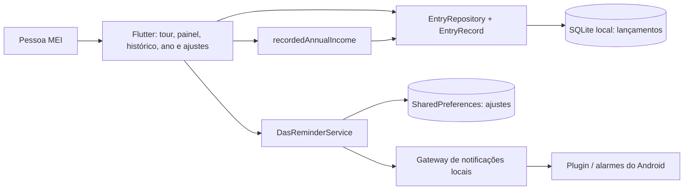

# NotaMei — requisitos e arquitetura compartilháveis

**Escopo:** MVP Android/Flutter para organização financeira manual de MEIs. Este documento sintetiza decisões de produto e a implementação versionada, para dar contexto a colaboradores e ao Hermes em outros computadores. Não contém respostas individuais, contagens de uma amostra pequena, anexos locais, referências de terceiros ou dados financeiros reais. O levantamento exploratório que ajudou a formular o problema **não representa a população de MEIs**; os requisitos abaixo são decisões de projeto e hipóteses a validar, não conclusões de pesquisa nem regras fiscais.

**Como ler os estados:** *implementado* significa presente no código; *observado no A17* indica um fluxo exercitado naquele aparelho numa versão de teste; *pendente* exige trabalho ou validação. Um teste automatizado ou um alarme agendado não prova entrega futura de aviso nem adequação fiscal.

## 1. Problema, objetivo e limites

O produto procura facilitar o registro de entradas e saídas do negócio, tornar explícita a distinção entre movimentações do negócio e pessoais e permitir consulta do histórico informado. O ator principal é a pessoa MEI que usa um telefone Android; a equipe do projeto pode orientar testes, mas **não recebe automaticamente** lançamentos ou acesso ao aparelho.

A primeira versão opera com lançamento **manual e local**. Não há integração bancária, conta no app, nuvem própria, sincronização, emissão de notas, cobrança, pagamento do DAS, exportação/backup próprios ou aconselhamento contábil automático. O foco extensionista inclui apresentar, observar o uso com consentimento e recolher feedback; a existência do app, por si, não demonstra impacto na comunidade.

## 2. Requisitos funcionais e situação no MVP

| ID | Necessidade / critério de aceitação | Situação e rastreio |
| --- | --- | --- |
| RF01 | Cadastrar entrada ou saída manual com valor positivo em reais, data, categoria e observação opcional; impedir valores inválidos e reencontrar o registro após reabrir. | **Implementado** em [`lib/finance/entry_form_screen.dart`](../../lib/finance/entry_form_screen.dart) e [`lib/data/entry_repository.dart`](../../lib/data/entry_repository.dart); persistência exercitada no A17. |
| RF02 | Marcar cada lançamento como Negócio ou Pessoal; registros pessoais não compõem os totais do negócio. A marcação **não separa contas bancárias**. | **Implementado** em [`lib/data/entry_record.dart`](../../lib/data/entry_record.dart), repositório e telas financeiras. |
| RF03 | Exibir entradas, saídas e balanço aritmético mensal do negócio; período e estado vazio devem estar visíveis. Não chamar a diferença de lucro ou saldo bancário. | **Implementado** em [`lib/finance/dashboard_screen.dart`](../../lib/finance/dashboard_screen.dart). |
| RF04 | Consultar por mês, filtrar Negócio/Pessoal e Entrada/Saída, editar e excluir com confirmação; atualizar os resumos após mudanças. | **Implementado** em [`lib/finance/entry_history_screen.dart`](../../lib/finance/entry_history_screen.dart), formulário e repositório; fluxos principais exercitados no A17. |
| RF05 | Gráfico mensal de entradas e saídas com rótulos e alternativa textual. | **Não implementado.** O painel atual usa números e lista, sem gráfico; decidir se a visualização adicional agrega valor após feedback. |
| RF06 | Lembrete **pessoal** do DAS com dia/hora escolhidos, permissão solicitada ao ativar e opção de cancelar; não presumir vencimento nem pagamento. | **Agendamento/cancelamento implementados** em [`lib/das/`](../../lib/das/). No A17 foram vistos alarmes criados e cancelados; a entrega em data futura, efeitos de bateria/fuso e variedade de aparelhos **não foram comprovados**. |
| RF07 | Acompanhar entradas comerciais informadas no ano, sem interpretar histórico parcial como ausência de movimento ou limite fiscal atendido. | **Soma descritiva implementada** em [`lib/annual/`](../../lib/annual/), apenas para entradas do negócio registradas no ano corrente. Aviso anual configurável, receita anterior declarada e comparações com limite legal **não implementados**. |
| RF10 | Tour opcional de três passos, opção de começar sem tour, pular para o Início, tela de conclusão distinta e reabertura em Ajustes sem apagar dados. | **Implementado** em [`lib/onboarding/`](../../lib/onboarding/) e [`lib/app/`](../../lib/app/); fluxo exercitado no A17. |
| RF08–09 | Relatórios detalhados, metas, comprovantes, fiado e sincronização entre dispositivos. | **Futuro**; exigem modelagem, privacidade, segurança e pesquisa de uso próprias. |

**Casos ainda sem regra fechada:** retirada do negócio para uso pessoal, transferência entre contas, venda parcelada, estorno, duplicidade e lançamento anterior à instalação. Uma classificação manual não resolve automaticamente esses casos; evite contabilizar a mesma movimentação duas vezes. Antes de automatizar qualquer comparação fiscal, definir o conceito de receita, cobertura do histórico, versão das regras e revisão por fonte oficial e especialista. Nenhum valor de teto ou data legal deve ser inferido do balanço de caixa.

## 3. Requisitos não funcionais e verificação

| Tema | Decisão / estado atual | Verificação que falta |
| --- | --- | --- |
| Offline | Cadastro e consulta usam SQLite no próprio aparelho; preferências e avisos são locais. | Repetir testes em modo avião e em outros Androids; internet pode ser necessária apenas para obter o APK ou outras tarefas fora do app. |
| Dinheiro e datas | Valores são centavos inteiros; somas têm validação de limite; datas de registros são exibidas em pt-BR e filtradas por mês/ano. | Testar cenários de data, mudança de ano e atualização de versão no aparelho. |
| Integridade | Operações de gravação precedem atualização visível; bloqueio de duplo toque no salvamento e tratamento de erro permitem nova tentativa. SQLite usa esquema versão 1. | Planejar migrações futuras e testar interrupção/atualização sem perda. |
| Privacidade | O app não oferece sincronização própria; registros ficam localmente. O sistema operacional pode ter política de backup própria. | Documentar e testar política de cópia/recuperação antes de depender de dados reais; avaliar riscos em aparelho perdido ou compartilhado. |
| Acessibilidade | Textos de erro e rótulos são necessários para uso sem depender só da cor; tour e navegação devem continuar utilizáveis sem animações. | Medir legibilidade, foco, áreas de toque e preferência por redução de movimento em testes observados. |
| Avisos | Alarmes locais dependem de permissão, sistema e economia de bateria. Dia 29–31 ajusta ao último dia em mês curto; agenda móvel de até 12 lembretes se renova ao abrir o app. | Observar a entrega real, reinício do aparelho, fuso horário e alterações de permissão; nunca prometer pontualidade. |

## 4. Arquitetura implementada

- [`lib/main.dart`](../../lib/main.dart) inicializa preferências, repositório e serviço DAS antes de abrir [`NotaMeiApp`](../../lib/app/notamei_app.dart). Falha de atualização de notificações não deve impedir acesso aos lançamentos.
- [`EntryRecord`](../../lib/data/entry_record.dart) tem identificador local, tipo, âmbito, valor em centavos, categoria textual, data e observação opcional. **Não** há tabela separada de categorias, UUID obrigatório nem dados históricos declarados pelo usuário nesta versão.
- [`EntryRepository`](../../lib/data/entry_repository.dart) persiste lançamentos em SQLite e expõe consultas/somas mensais do negócio. As telas chamam o repositório diretamente; **não** existe uma camada formal separada de casos de uso nesta implementação. A soma anual filtra entradas comerciais do ano selecionado.
- [`DasReminderService`](../../lib/das/das_reminder_service.dart) guarda preferências e usa um gateway de notificações; a ponte Android em [`local_das_gateway.dart`](../../lib/das/local_das_gateway.dart) agenda/cancela identificadores próprios. Uma falha parcial deve desativar a preferência e tentar cancelar alarmes próprios.
- Não existe servidor, API, PostgreSQL, autenticação nem sincronização na arquitetura atual. São opções **futuras**, dependentes de decisão de produto, proteção de dados, resolução de conflitos e testes; não pré-requisitos para o MVP offline.

## 5. Próximas validações e decisões

1. Conduzir uso observado com consentimento e exemplos fictícios; registrar feedback agregado sobre rapidez, classificação, compreensão do balanço e recuperação de dados. Definir critérios e participantes antes de relatar impacto; não atribuir resultados ao projeto sem medição.
2. Definir o tratamento de retirada/transferência, histórico anterior e eventuais alertas anuais com revisão de domínio. Enquanto isso, manter o acompanhamento descritivo, sem conclusão fiscal.
3. Planejar exportação/restauração e migração de banco antes de uso prolongado; a desinstalação/limpeza de dados pode remover registros locais.
4. Validar acessibilidade, funcionamento em modo avião e entrega de lembretes em datas reais. Preparar assinatura e atualização de APKs de teste antes de ampliar a distribuição.

**Origem e proteção:** síntese de planejamento e levantamento exploratório interno, confrontada com arquivos versionados do MVP. Evidências individuais e a análise detalhada original permanecem **locais e ignoradas pelo Git**; este resumo é o único documento de requisitos/arquitetura desta área destinado a compartilhamento remoto.
