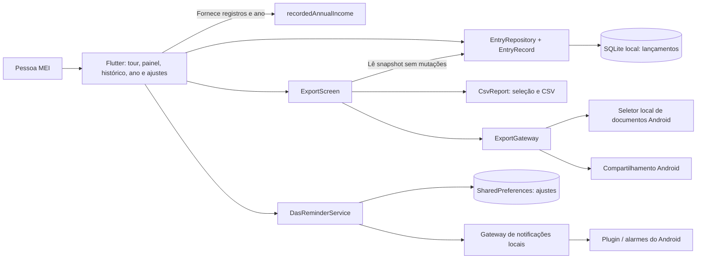

# NotaMei — requisitos e arquitetura compartilháveis

**Escopo:** MVP Android/Flutter para organização financeira manual de MEIs. Este documento sintetiza decisões de produto e a implementação versionada, para dar contexto a colaboradores e ao Hermes em outros computadores. Não contém respostas individuais, contagens de uma amostra pequena, anexos locais, referências de terceiros ou dados financeiros reais. O levantamento exploratório que ajudou a formular o problema **não representa a população de MEIs**; os requisitos abaixo são decisões de projeto e hipóteses a validar, não conclusões de pesquisa nem regras fiscais.

**Como ler os estados:** *implementado* significa presente no código; *observado no A17* indica um fluxo exercitado naquele aparelho numa versão de teste; *pendente* exige trabalho ou validação. Um teste automatizado ou um alarme agendado não prova entrega futura de aviso nem adequação fiscal.

## 1. Problema, objetivo e limites

O produto procura facilitar o registro de entradas e saídas do negócio, tornar explícita a distinção entre movimentações do negócio e pessoais e permitir consulta do histórico informado. O ator principal é a pessoa MEI que usa um telefone Android; a equipe do projeto pode orientar testes, mas **não recebe automaticamente** lançamentos ou acesso ao aparelho.

A primeira versão opera com lançamento **manual e local**. Não há integração bancária, conta no app, nuvem própria, sincronização, emissão de notas, cobrança, pagamento do DAS, backup/restauração próprios, exportação PDF ou aconselhamento contábil automático. A **exportação de relatório CSV** (Ajustes → Exportar CSV) está implementada para levar os dados para fora do app; o CSV **não é backup restaurável nem documento fiscal**. O foco extensionista inclui apresentar, observar o uso com consentimento e recolher feedback; a existência do app, por si, não demonstra impacto na comunidade.

## 2. Requisitos funcionais e situação no MVP

| ID | Necessidade / critério de aceitação | Situação e rastreio |
| --- | --- | --- |
| RF01 | Cadastrar entrada ou saída manual com valor positivo em reais, data, categoria e observação opcional; impedir valores inválidos e reencontrar o registro após reabrir. | **Implementado** em [`lib/finance/entry_form_screen.dart`](../../lib/finance/entry_form_screen.dart) e [`lib/data/entry_repository.dart`](../../lib/data/entry_repository.dart); persistência exercitada no A17. |
| RF02 | Marcar cada lançamento como Negócio ou Pessoal; registros pessoais não compõem os totais do negócio. A marcação **não separa contas bancárias**. | **Implementado** em [`lib/data/entry_record.dart`](../../lib/data/entry_record.dart), repositório e telas financeiras. |
| RF03 | Exibir entradas, saídas e balanço aritmético mensal do negócio; período e estado vazio devem estar visíveis. Não chamar a diferença de lucro ou saldo bancário. | **Implementado** em [`lib/finance/dashboard_screen.dart`](../../lib/finance/dashboard_screen.dart). |
| RF04 | Consultar por mês, filtrar Negócio/Pessoal e Entrada/Saída, editar e excluir com confirmação; atualizar os resumos após mudanças. | **Implementado** em [`lib/finance/entry_history_screen.dart`](../../lib/finance/entry_history_screen.dart), formulário e repositório; fluxos principais exercitados no A17. |
| RF05 | Gráfico mensal de entradas e saídas com rótulos e alternativa textual. | **Não implementado.** O painel atual usa números e lista, sem gráfico; decidir se a visualização adicional agrega valor após feedback. |
| RF06 | Lembrete **pessoal** do DAS com dia/hora escolhidos, permissão solicitada ao ativar e opção de cancelar; não presumir vencimento nem pagamento. | **Agendamento/cancelamento implementados** em [`lib/das/`](../../lib/das/). No A17 foram vistos alarmes criados e cancelados; a entrega em data futura, efeitos de bateria/fuso e variedade de aparelhos **não foram comprovados**. |
| RF07 | Acompanhar entradas comerciais informadas no ano, sem interpretar histórico parcial como ausência de movimento ou limite fiscal atendido. | **Soma descritiva implementada** em [`lib/annual/`](../../lib/annual/), apenas para entradas do negócio registradas no ano corrente. Aviso anual configurável, receita anterior declarada e comparações com limite legal **não implementados**. |
| RF10 | Tour opcional de três passos, opção de começar sem tour, pular para o Início, tela de conclusão distinta e reabertura em Ajustes sem apagar dados. | **Implementado** em [`lib/onboarding/`](../../lib/onboarding/) e [`lib/app/`](../../lib/app/); fluxo exercitado no A17. |
| RF08–09 | Relatórios detalhados, metas, comprovantes, fiado e sincronização entre dispositivos. | **Parcial:** relatório CSV por período e filtros implementado em FB04; PDF, metas, comprovantes, fiado e sincronização continuam futuros, com requisitos próprios. |

**Casos ainda sem regra fechada:** retirada do negócio para uso pessoal, transferência entre contas, venda parcelada, estorno, duplicidade e lançamento anterior à instalação. Uma classificação manual não resolve automaticamente esses casos; evite contabilizar a mesma movimentação duas vezes. Antes de automatizar qualquer comparação fiscal, definir o conceito de receita, cobertura do histórico, versão das regras e revisão por fonte oficial e especialista. Nenhum valor de teto ou data legal deve ser inferido do balanço de caixa.

## 3. Requisitos não funcionais e verificação

| Tema | Decisão / estado atual | Verificação que falta |
| --- | --- | --- |
| Offline | Cadastro e consulta usam SQLite no próprio aparelho; preferências e avisos são locais. | Repetir testes em modo avião e em outros Androids; internet pode ser necessária apenas para obter o APK ou outras tarefas fora do app. |
| Dinheiro e datas | Valores são centavos inteiros; somas têm validação de limite; datas de registros são exibidas em pt-BR e filtradas por mês/ano. | Testar cenários de data, mudança de ano e atualização de versão no aparelho. |
| Integridade | Operações de gravação precedem atualização visível; bloqueio de duplo toque no salvamento e tratamento de erro permitem nova tentativa. SQLite usa esquema versão 1. | Planejar migrações futuras e testar interrupção/atualização sem perda. |
| Privacidade | O app não oferece sincronização própria; registros ficam localmente. O sistema operacional pode ter política de backup própria. | Documentar e testar política de cópia/recuperação antes de depender de dados reais; avaliar riscos em aparelho perdido ou compartilhado. |
| Acessibilidade | Textos de erro e rótulos são necessários para uso sem depender só da cor; tour e navegação devem continuar utilizáveis sem animações. | Medir legibilidade, foco, áreas de toque e preferência por redução de movimento em testes observados. |
| Avisos | Alarmes locais dependem de permissão, sistema e economia de bateria. Dia 29–31 ajusta ao último dia em mês curto; agenda móvel de até 12 lembretes se renova ao abrir o app. | Observar a entrega real, reinício do aparelho, fuso horário e alterações de permissão; nunca prometer pontualidade. |

## 4. Arquitetura implementada

- [`lib/main.dart`](../../lib/main.dart) inicializa preferências, repositório e serviço DAS antes de abrir [`NotaMeiApp`](../../lib/app/notamei_app.dart). Falha de atualização de notificações não deve impedir acesso aos lançamentos.
- [`EntryRecord`](../../lib/data/entry_record.dart) tem identificador local, tipo, âmbito, valor em centavos, categoria textual, data e observação opcional. **Não** há tabela separada de categorias, UUID obrigatório nem dados históricos declarados pelo usuário nesta versão.
- [`EntryRepository`](../../lib/data/entry_repository.dart) persiste lançamentos em SQLite e expõe consultas/somas mensais do negócio. As telas chamam o repositório diretamente; **não** existe uma camada formal separada de casos de uso nesta implementação. A soma anual filtra entradas comerciais do ano selecionado.
- [`DasReminderService`](../../lib/das/das_reminder_service.dart) guarda preferências e usa um gateway de notificações; a ponte Android em [`local_das_gateway.dart`](../../lib/das/local_das_gateway.dart) agenda/cancela identificadores próprios. Uma falha parcial deve desativar a preferência e tentar cancelar alarmes próprios.
- Não existe servidor, API, PostgreSQL, autenticação nem sincronização na arquitetura atual. São opções **futuras**, dependentes de decisão de produto, proteção de dados, resolução de conflitos e testes; não pré-requisitos para o MVP offline.
- [`lib/export/`](../../lib/export/) separa seleção/prévia (`ExportScreen`), geração determinística (`CsvReport`) e saída nativa (`ExportGateway`). A tela lê o snapshot e fornece o relatório ao gateway; não há escrita no repositório nem alteração do esquema SQLite. Arquivos e apps destinatários ficam fora do controle do NotaMei. Consulte [escopo, validação e rollback do CSV](EXPORTACAO-CSV.md).

## 5. Próximas validações e decisões

1. Conduzir uso observado com consentimento e exemplos fictícios; registrar feedback agregado sobre rapidez, classificação, compreensão do balanço e recuperação de dados. Definir critérios e participantes antes de relatar impacto; não atribuir resultados ao projeto sem medição.
2. Definir o tratamento de retirada/transferência, histórico anterior e eventuais alertas anuais com revisão de domínio. Enquanto isso, manter o acompanhamento descritivo, sem conclusão fiscal.
3. Planejar backup/restauração e migração de banco antes de uso prolongado. A exportação CSV disponível não permite restaurar o banco; a desinstalação/limpeza de dados pode remover registros locais.
4. Validar acessibilidade, funcionamento em modo avião e entrega de lembretes em datas reais. Preparar assinatura e atualização de APKs de teste antes de ampliar a distribuição.

## 6. Feedbacks para evolução — implementação e pendências

**Origem e estado:** demandas relatadas pelo responsável após feedback de uso, sem relatos individuais ou comprovação de representatividade. FB01 e FB02 foram implementados na evolução anterior; FB04 foi autorizado pelo responsável e implementado nesta evolução CSV. A validação física da nova versão permanece pendente. FB03, FB05 e FB06 continuam propostas a refinar; FB07 só deve ser avaliado após o lançamento. FB08 registra o feedback sobre pró-labore/remuneração da pessoa MEI, reservado para análise futura. Os identificadores FB01–FB08 preservam o rastreio sem renumerar requisitos.

| ID | Feedback / evolução solicitada | Estado e relação com o MVP |
| --- | --- | --- |
| FB01 | Permitir vários lançamentos seguidos sem sair do formulário após cada salvamento. | **Implementado nesta evolução.** Complementa RF01 com “Salvar e adicionar outro”; o salvamento normal continua retornando à tela anterior. Rastreio: `lib/finance/entry_form_screen.dart` e `test/finance/entry_sequence_test.dart`. |
| FB02 | Oferecer filtro no Início para consultar além dos totais do negócio. | **Implementado nesta evolução.** Negócio/Pessoal/Todos filtram totais e recentes, com Negócio como padrão. Rastreio: `lib/finance/dashboard_screen.dart` e `test/finance/dashboard_scope_test.dart`; não altera o anual comercial de RF07. |
| FB03 | Ler QR Code e código de barras para facilitar o lançamento de compras, inclusive uma compra completa. | **Proposta futura.** Ainda é necessário definir quais códigos/documentos serão aceitos e se a compra será registrada pelo total ou por itens. Reconhecer um código não significa obter automaticamente todos os dados da compra. |
| FB04 | Exportar dados por dia, semana, mês ou ano em CSV. | **Implementado** na branch `feature/exportacao-csv`: Ajustes → Exportar CSV, períodos ancorados em uma data, filtros de âmbito/tipo, observações opt-in, prévia e saída local/nativa. Não é backup restaurável nem documento fiscal. Rastreio: `lib/export/`, `test/export/` e [documentação do CSV](EXPORTACAO-CSV.md). |
| FB05 | Exportar dados por dia, semana, mês ou ano em PDF. | **Proposta futura.** Compartilha as regras de seleção de FB04, com apresentação própria para leitura/impressão; não há geração de PDF implementada. |
| FB06 | Integrar uma IA local simples para ajudar a pessoa MEI, com evolução para uso online e offline. | **Proposta futura, dependente de prova de conceito e escopo.** O app atual não contém IA nem serviços online próprios. IA local não exige, por si só, processamento em nuvem. |
| FB07 | Disponibilizar uma versão Lite. | **Somente após o lançamento do app**, conforme orientação do responsável. Não há escopo, data ou divisão de versões definidos. |
| FB08 | Verificar o tratamento de pró-labore/remuneração quando a pessoa MEI quiser se pagar. | **Anotado para análise futura, sem implementação autorizada.** Definir o fluxo de retirada do negócio para uso pessoal, a classificação e o efeito nos resumos, evitando contagem duplicada. Regras contábeis/fiscais e critérios de aceitação permanecem em aberto. |

### 6.1. Lançamentos em sequência (FB01)

- **Objetivo:** reduzir a repetição de navegação ao registrar várias movimentações.
- **Aceitação proposta:** após persistir um novo lançamento, permitir continuar no formulário, com confirmação visível do sucesso e uma forma clara de concluir/voltar. Cada salvamento deve criar somente um registro, atualizar as consultas e manter a proteção contra duplo toque.
- **Falhas:** se a gravação falhar, conservar os dados preenchidos e permitir nova tentativa sem indicar sucesso nem duplicar registros.
- **Decisão implementada:** oferecer “Salvar e adicionar outro” somente no cadastro. Após sucesso, limpar valor/observação, manter tipo/âmbito/categoria/data, anunciar a confirmação sem sobrepor os botões e devolver foco ao valor. Preservar o botão normal de salvar e voltar. Bloquear os dois salvamentos, digitação e retorno durante a gravação; na edição, manter apenas a atualização do registro existente. Mudança de seleção/categoria e data continua sendo feita pela pessoa, sem valores pré-definidos pelo filtro do Início.
- **Verificação proposta:** cadastrar movimentações consecutivas com dados fictícios, conferir quantidade e valores após reabrir, simular falha e verificar saída voluntária do formulário.

### 6.2. Filtro no Início (FB02)

- **Objetivo:** permitir uma visão explícita de movimentações pessoais e comerciais, sem apresentar números de um âmbito como se pertencessem a outro.
- **Aceitação proposta:** mostrar o filtro e o mês ativos, recalcular os indicadores e tornar claro a qual âmbito pertencem os registros recentes. Manter RF02: valores pessoais não entram em um total identificado como do negócio.
- **Decisão implementada:** Negócio/Pessoal/Todos, com Negócio como seleção inicial. Filtrar totais, recentes e estado vazio em conjunto. Todos identifica “Balanço geral” e “Negócio + Pessoal”, sem rotular a soma como comercial. Manter a seleção ao trocar o mês ou navegar e voltar, sem persistência após reiniciar o app. Somas fora do intervalo suportado exibem aviso e substituem os totais por travessões, sem mostrar resultado parcial ou alterar registros.
- **Verificação proposta:** usar entradas e saídas de ambos os âmbitos no mesmo mês, alternar filtros e meses e conferir rótulos, valores e estado vazio. Não alterar silenciosamente o cálculo anual comercial de RF07.

### 6.3. Captura e revisão de compras (FB03)

- **Distinguir os casos:** código de produto, QR Code de documento/consulta e reconhecimento de texto de uma foto são fluxos diferentes. Leitura de QR/código de barras não inclui automaticamente OCR, consulta fiscal, catálogo de produtos ou integração bancária.
- **Aceitação proposta:** capturar um formato suportado, identificar o que foi lido, apresentar os dados obtidos em uma prévia editável e salvar somente após confirmação. Informações ausentes não devem ser inventadas; deve existir alternativa manual.
- **Decisões abertas:** documentos e formatos prioritários, origem dos dados, necessidade de internet, lançamento único pelo total ou detalhamento por itens, tratamento de desconto/frete e como reconhecer uma compra já registrada. Não confundir repetição de um código de produto com duplicidade de uma compra.
- **Integridade e segurança:** impedir salvamentos repetidos da mesma operação; definir prevenção de duplicidade entre importação e lançamento manual. Tratar o conteúdo lido como entrada não confiável, validar endereços antes de qualquer consulta e solicitar permissão de câmera apenas quando necessária ao fluxo escolhido. Não enviar documentos a terceiros sem informar a pessoa e obter autorização apropriada.
- **Verificação proposta:** código válido, desconhecido e ilegível; permissão negada; leitura repetida; ausência de internet quando houver consulta; cancelamento da prévia e correção manual antes de salvar.

### 6.4. Exportação CSV e PDF (FB04–FB05)

- **CSV (FB04) — implementado.** Ajustes → Exportar CSV: data de referência, dia/semana (segunda–domingo)/mês/ano, intervalo civil inclusivo; Negócio padrão, Pessoal ou Todos; ambos os tipos ou um só; observações opt-in. UTF-8 BOM, delimitador `;`, decimal vírgula sem milhares, centavos exatos e totais `BigInt`; linhas uniformes de lançamentos e resumo com filtros explícitos. Textos perigosos recebem TAB dentro das aspas, com escape de aspas internas; não há garantia universal de segurança em planilhas nem de preservação da mitigação por outros programas. Salvar usa seletor local; compartilhar usa a interface nativa, sem comprovar transmissão final. Não altera banco ou esquema. Testes unitários usam registros sintéticos; fronteiras nativas são simuladas, sem validação de gravação/compartilhamento em aparelho nesta sessão. [Detalhes e rollback](EXPORTACAO-CSV.md).
- **PDF (FB05) — proposta futura.** Compartilha regras de seleção do CSV; apresentação própria para leitura/impressão; não há geração de PDF implementada. O relatório não é documento fiscal nem confirmação de regularidade.
- **Privacidade e recuperação (comum):** gerar localmente sempre que o escopo permitir e não compartilhar automaticamente. Avisar que o arquivo contém dados financeiros. Exportação de relatório não implica importação, restauração ou backup; esses recursos precisam de requisitos próprios.

### 6.5. Assistência local e operação online/offline (FB06)

- **Objetivo a refinar:** definir tarefas úteis e limitadas, como sugerir categoria, explicar indicadores ou ajudar a encontrar registros. Essas tarefas são exemplos para avaliação, não funcionalidades aprovadas em conjunto.
- **Aceitação proposta:** manter cadastro e consulta manuais utilizáveis offline e sem IA; distinguir processamento local de eventual serviço online. A indisponibilidade do modelo ou da rede não deve bloquear o núcleo financeiro.
- **Decisões abertas:** regras determinísticas ou modelo generativo; quais tarefas exigem IA; aparelhos mínimos; tamanho, licença, download e atualização do modelo; limites de memória, tempo de resposta e bateria. Se houver serviço online, definir backend, custo, autenticação quando necessária, consentimento, dados enviados, retenção e comportamento sem rede. Online/offline não significa sincronização de dados entre aparelhos por padrão.
- **Confiabilidade:** cálculos monetários devem continuar a cargo de código determinístico. Sugestões não devem criar, editar ou excluir lançamentos sem confirmação; texto de documentos e registros deve ser tratado como dado, não como instrução ao assistente. Não apresentar orientação fiscal automática como decisão oficial nem garantir respostas corretas.
- **Verificação proposta:** prova de conceito em aparelhos representativos, tarefas com respostas verificáveis, dados insuficientes, modelo ausente, falhas de rede e revisão das permissões e do acesso aos registros. Não anunciar compatibilidade universal antes dessa validação.

### 6.6. Versão Lite e referências visuais (FB07)

- **Momento:** avaliar apenas após o lançamento e o uso da versão principal. Definir o que “Lite” significa para o público: tamanho do download, armazenamento, memória, consumo de rede ou conjunto de recursos.
- **Decisão arquitetural pendente:** preferir avaliar módulos/configurações sobre uma base compartilhada antes de duplicar o projeto; não criar agora outro aplicativo, pacote ou banco incompatível. Compatibilidade de dados e eventual migração entre versões precisam de critérios próprios.
- **Telas:** refinar primeiro os fluxos e estados necessários para sequência de lançamentos, filtro, captura/revisão de compra, seleção de exportação e assistência. Depois decidir quais telas novas ou ajustes gerar no Stitch. As versões alternativas existentes são referências, não requisitos automaticamente aprovados.
- **Planejamento:** FB01 e FB02 foram a primeira evolução; o responsável aprovou a implementação CSV (FB04) em seguida. Não há prazo ou ordem de entrega aprovados para FB03, FB05 e FB06. Captura completa de compras e IA exigem investigação antes de ampliar o MVP.

### 6.7. Validações históricas e evolução CSV

- **Histórico FB01/FB02, antes do V5:** a documentação anterior registra análise limpa, 76 testes aprovados e APK em emulador Android API 36. Foram exercitados sequência, filtros, separação do anual e persistência; isso não é uma nova execução nesta sessão.
- **Histórico V5:** [V5-IMPLEMENTACAO.md](V5-IMPLEMENTACAO.md) registra 95 testes aprovados. O baseline desta implementação CSV foi novamente executado e também passou nos 95 testes, antes das alterações.
- **Evolução CSV atual:** suíte integrada final com **110 testes aprovados**, análise estática sem problemas e APK debug reconstruído após o reforço da mitigação de fórmulas. O build avisou que `flutter_file_dialog` usa o plugin Kotlin Gradle e exigirá atenção em versões futuras do Flutter. `lib/data/`, esquema SQLite e serviço de lembretes não foram alterados.
- **Limites atuais:** nenhum dispositivo conectado; salvar/compartilhar nativos não foram exercitados em aparelho nesta sessão. Testes unitários verificam geração e seleção com dados sintéticos; testes de widget verificam prévia, filtros, falhas, cancelamento, vazio, ação duplicada e 390 px com texto 2x. Isso não certifica usabilidade universal nem entrega futura de notificações.
- **Reproduzir:** `flutter analyze`, `flutter test` e `flutter build apk --debug`. Consulte [exportação CSV](EXPORTACAO-CSV.md) para formato, privacidade e rollback.

### 6.8. Pró-labore e remuneração da pessoa MEI (FB08)

- **Feedback registrado:** verificar como o NotaMei deve atender a pessoa MEI que deseja se pagar, referido pelo responsável como questão do pró-labore.
- **Estado:** apenas uma anotação de backlog para analisar com mais calma; não define regra de negócio, prioridade, prazo ou autorização para implementar.
- **Questões para a análise futura:** como registrar a retirada do negócio para o âmbito pessoal; quais rótulos/classificações usar; como refletir a operação nos resumos e relatórios sem duplicar movimentações. Não pressupor que retirada, transferência e pró-labore sejam conceitos equivalentes.
- **Limite:** eventual tratamento contábil/fiscal exige definição e validação próprias nessa análise futura. Nenhum cálculo, obrigação ou classificação fiscal foi estabelecido por esta anotação.

**Origem e proteção:** síntese de planejamento e levantamento exploratório interno, confrontada com arquivos versionados do MVP, acrescida dos feedbacks de evolução relatados pelo responsável pelo projeto. Evidências individuais e a análise detalhada original permanecem **locais e ignoradas pelo Git**; este resumo e a [documentação de arquitetura C4](../arquitetura/C4-NOTAMEI.md) são sínteses revisadas destinadas a compartilhamento remoto, sem os anexos nem respostas individuais.
