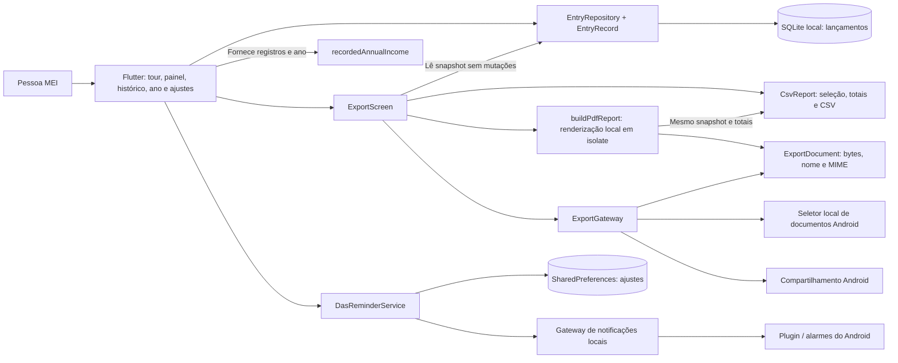

# NotaMei — requisitos e arquitetura compartilháveis

**Escopo:** MVP Android/Flutter para organização financeira manual de MEIs. Este documento sintetiza decisões de produto e a implementação versionada, para dar contexto a colaboradores e ao Hermes em outros computadores. Não contém respostas individuais, contagens de uma amostra pequena, anexos locais, referências de terceiros ou dados financeiros reais. O levantamento exploratório que ajudou a formular o problema **não representa a população de MEIs**; os requisitos abaixo são decisões de projeto e hipóteses a validar, não conclusões de pesquisa nem regras fiscais.

**Como ler os estados:** *implementado* significa presente no código; *observado no A17* indica um fluxo exercitado naquele aparelho numa versão de teste; *pendente* exige trabalho ou validação. Um teste automatizado ou um alarme agendado não prova entrega futura de aviso nem adequação fiscal.

## 1. Problema, objetivo e limites

O produto procura facilitar o registro de entradas e saídas do negócio, tornar explícita a distinção entre movimentações do negócio e pessoais e permitir consulta do histórico informado. O ator principal é a pessoa MEI que usa um telefone Android; a equipe do projeto pode orientar testes, mas **não recebe automaticamente** lançamentos ou acesso ao aparelho.

A primeira versão opera com lançamento **manual e local**. Não há integração bancária, conta no app, nuvem própria, sincronização, emissão de notas, cobrança, pagamento do DAS, backup/restauração próprios ou aconselhamento contábil automático. **Relatórios CSV e PDF**, acessíveis em Ajustes, estão implementados para levar os dados para fora do app; **não são backups restauráveis nem documentos fiscais**. O foco extensionista inclui apresentar, observar o uso com consentimento e recolher feedback; a existência do app, por si, não demonstra impacto na comunidade.

## 2. Requisitos funcionais e situação no MVP

| ID | Necessidade / critério de aceitação | Situação e rastreio |
| --- | --- | --- |
| RF01 | Cadastrar entrada ou saída manual com valor positivo em reais, data, categoria e observação opcional; impedir valores inválidos e reencontrar o registro após reabrir. | **Implementado** em [`lib/finance/entry_form_screen.dart`](../../lib/finance/entry_form_screen.dart) e [`lib/data/entry_repository.dart`](../../lib/data/entry_repository.dart); persistência exercitada no A17. |
| RF02 | Marcar cada lançamento como Negócio ou Pessoal; registros pessoais não compõem os totais do negócio. A marcação **não separa contas bancárias**. | **Implementado** em [`lib/data/entry_record.dart`](../../lib/data/entry_record.dart), repositório e telas financeiras. |
| RF03 | Exibir entradas, saídas e balanço aritmético mensal do negócio; período e estado vazio devem estar visíveis. Não chamar a diferença de lucro ou saldo bancário. | **Implementado** em [`lib/finance/dashboard_screen.dart`](../../lib/finance/dashboard_screen.dart). |
| RF04 | Consultar por mês, filtrar Negócio/Pessoal e Entrada/Saída, editar e excluir com confirmação; atualizar os resumos após mudanças. | **Implementado** em [`lib/finance/entry_history_screen.dart`](../../lib/finance/entry_history_screen.dart), formulário e repositório; fluxos principais exercitados no A17. |
| RF05 | Gráfico mensal de entradas e saídas com rótulos e alternativa textual. | **Não implementado.** O painel atual usa números e lista, sem gráfico; decidir se a visualização adicional agrega valor após feedback. |
| RF06 | Lembrete **pessoal** do DAS com dia/hora escolhidos, permissão solicitada ao ativar e opção de cancelar; não presumir vencimento nem pagamento. | **Agendamento/cancelamento implementados** em [`lib/das/`](../../lib/das/). No A17 foram vistos alarmes criados e cancelados; a entrega em data futura, efeitos de bateria/fuso e variedade de aparelhos **não foram comprovados**. |
| RF07 | Acompanhar entradas comerciais informadas no ano, sem interpretar histórico parcial como ausência de movimento ou limite fiscal atendido. | **Soma descritiva implementada** em [`lib/annual/`](../../lib/annual/), apenas para entradas do negócio registradas no ano corrente. Aviso anual configurável, receita anterior declarada e comparações com limite legal **não implementados**. |
| RF10 | Tour opcional de três passos, opção de começar sem tour, pular para o Início, tela de conclusão distinta e reabertura em Ajustes sem apagar dados. | **Implementado** em [`lib/onboarding/`](../../lib/onboarding/) e [`lib/app/`](../../lib/app/); fluxo exercitado no A17. |
| RF08–09 | Relatórios detalhados, metas, comprovantes, fiado e sincronização entre dispositivos. | **Parcial:** relatórios CSV/PDF por período e filtros implementados em FB04/FB05; metas, comprovantes, fiado e sincronização continuam futuros, com requisitos próprios. |

**Casos ainda sem regra fechada:** transferências entre contas em geral, venda parcelada, estorno, duplicidade e lançamento anterior à instalação. A retirada do titular tem recorte manual definido e implementado em FB08 (Negócio → Pessoal, sem contagem duplicada), sem classificação fiscal automática. Uma classificação manual não resolve automaticamente os demais casos. Antes de automatizar qualquer comparação fiscal, definir o conceito de receita, cobertura do histórico, versão das regras e revisão por fonte oficial e especialista. Nenhum valor de teto ou data legal deve ser inferido do balanço de caixa.

### 2.1. Regras de negócio (RN)

**Finalidade:** os RF descrevem capacidades do produto; as RN abaixo explicitam condições, restrições e significado das operações. Os RNF da seção 3 tratam das características técnicas e de qualidade. Os identificadores **RN01–RN24** são próprios deste catálogo e não substituem nem renumeram RF, US ou FB.

**Base e estado:** regras confrontadas com `c57cabe`, incluindo a retirada FB08, e estendidas ao PDF na branch `feature/exportacao-pdf` sem renumerar as RN. *Implementada* significa presente no recorte de código indicado; a referência a um teste identifica cobertura existente, não uma nova execução nem aprovação fiscal. Este catálogo não transforma propostas do backlog em regras autorizadas e não estabelece legislação ou obrigações contábeis.

#### 2.1.1. Lançamentos e classificação

| ID | Regra implementada | Rastreio de código e cobertura existente |
| --- | --- | --- |
| **RN01** | **Registro manual e natureza.** Cada lançamento possui um identificador, um tipo — Entrada ou Saída — e um âmbito — Negócio ou Pessoal. A pessoa informa os dados; não há importação bancária nem classificação automática. A direção do movimento é dada pelo tipo, não por sinal negativo no valor. | [`EntryRecord`](../../lib/data/entry_record.dart), [`EntryFormScreen`](../../lib/finance/entry_form_screen.dart); [`notamei_finance_test.dart`](../../test/finance/notamei_finance_test.dart). |
| **RN02** | **Valor positivo em reais.** Os formulários aceitam valores estritamente positivos no formato pt-BR, com vírgula decimal opcional e até duas casas; o ponto só pode agrupar milhares corretamente. Exemplos aceitos: `12`, `12,3`, `1.234,56`. Zero, sinais, símbolo de moeda no campo e ponto decimal são recusados. A conversão é exata para centavos inteiros, respeitando `maxMoneyCents`; esse limite é técnico, **não** teto de faturamento do MEI. Saída também é informada com valor positivo. | [`money.dart`](../../lib/core/money.dart); [`money_test.dart`](../../test/core/money_test.dart). |
| **RN03** | **Dados de classificação e observação.** O lançamento precisa de data e categoria não vazia; a observação é opcional. A tela oferece categorias predefinidas conforme tipo e âmbito; criação de categorias próprias não está implementada. Uma categoria chamada “Retirada do titular” em registro comum não cria vínculo de retirada: a natureza interna depende de `withdrawalId` (RN10). | [`entry_record.dart`](../../lib/data/entry_record.dart), [`entry_form_screen.dart`](../../lib/finance/entry_form_screen.dart); [`entry_repository_test.dart`](../../test/data/entry_repository_test.dart), [`withdrawal_test.dart`](../../test/data/withdrawal_test.dart). |
| **RN04** | **Data do registro e período civil.** Mês e ano são determinados pela data informada no lançamento, não pelo instante da gravação ou da instalação. Consultas mensais/anuais e seleção de CSV/PDF usam os componentes civis registrados, sem converter o lançamento para outro fuso. Isso não identifica competência contábil nem comprova completude do histórico. Não há regra fiscal de retroatividade/provisão estabelecida pelo app. | [`EntryRepository.forMonth`](../../lib/data/entry_repository.dart), [`annual_summary.dart`](../../lib/annual/annual_summary.dart), [`csv_export.dart`](../../lib/export/csv_export.dart); [`entry_repository_test.dart`](../../test/data/entry_repository_test.dart), [`csv_export_test.dart`](../../test/export/csv_export_test.dart). |
| **RN05** | **Correção de lançamento comum.** Editar conserva o identificador e substitui os dados do registro, sem criar outra operação. Excluir exige confirmação na interface; cancelar mantém o registro. Uma correção deve refletir nas consultas e nos resumos. Pontas de retirada não podem ser corrigidas isoladamente pelo formulário comum (RN12). | [`entry_form_screen.dart`](../../lib/finance/entry_form_screen.dart), [`entry_repository.dart`](../../lib/data/entry_repository.dart); [`notamei_finance_test.dart`](../../test/finance/notamei_finance_test.dart), [`withdrawal_test.dart`](../../test/data/withdrawal_test.dart). |

#### 2.1.2. Resumos e significado financeiro

| ID | Regra implementada | Rastreio de código e cobertura existente |
| --- | --- | --- |
| **RN06** | **Separação de âmbitos e movimentos externos.** Um total identificado como do Negócio considera somente o âmbito Negócio; Pessoal considera somente Pessoal. “Todos” agrega os dois âmbitos. Os indicadores Entradas/Saídas somam apenas lançamentos comuns, **excluindo as pontas internas da retirada**; recebidas/enviadas são demonstradas separadamente. Classificar um registro não separa contas bancárias. | [`entry_totals.dart`](../../lib/data/entry_totals.dart), [`dashboard_screen.dart`](../../lib/finance/dashboard_screen.dart); [`dashboard_scope_test.dart`](../../test/finance/dashboard_scope_test.dart), [`withdrawal_totals_test.dart`](../../test/finance/withdrawal_totals_test.dart). |
| **RN07** | **Balanço dos registros.** Em um âmbito individual: `entradas comuns − saídas comuns + internas recebidas − internas enviadas`. No recorte atual, Negócio envia retiradas e Pessoal recebe. Em Todos: `entradas comuns − saídas comuns`, sem efeito das pontas internas, inclusive em CSV/PDF com um único tipo selecionado. O número descreve a seleção, não lucro, patrimônio ou saldo bancário. | [`EntryTotals`](../../lib/data/entry_totals.dart), [`CsvReport`](../../lib/export/csv_export.dart); [`withdrawal_totals_test.dart`](../../test/finance/withdrawal_totals_test.dart), [`withdrawal_csv_test.dart`](../../test/export/withdrawal_csv_test.dart). |
| **RN08** | **Histórico parcial e capacidade de pagamento.** Balanço negativo é permitido, inclusive após retirada; não existe bloqueio por suposto saldo disponível. Valor positivo não comprova capacidade de pagamento, e ausência de lançamentos não prova ausência de movimento. Não inferir regularidade fiscal ou que todas as operações foram informadas. | [`dashboard_screen.dart`](../../lib/finance/dashboard_screen.dart), [`withdrawal_form_screen.dart`](../../lib/finance/withdrawal_form_screen.dart), [`annual_income_screen.dart`](../../lib/annual/annual_income_screen.dart); [`withdrawal_test.dart`](../../test/data/withdrawal_test.dart), [`annual_income_screen_test.dart`](../../test/annual/annual_income_screen_test.dart). |
| **RN09** | **Acompanhamento anual comercial.** Somar somente entradas comuns do Negócio com data no ano considerado, discriminadas por mês. Não deduzir saídas, não adicionar entradas pessoais ou retiradas e não tratar o resultado como faturamento fiscal certificado. A tela atual acompanha o ano corrente; receitas anteriores declaradas, comparação com teto legal e alerta fiscal não estão implementados. | [`recordedAnnualIncome`](../../lib/annual/annual_summary.dart), [`annual_income_screen.dart`](../../lib/annual/annual_income_screen.dart); [`annual_summary_test.dart`](../../test/annual/annual_summary_test.dart), [`withdrawal_totals_test.dart`](../../test/finance/withdrawal_totals_test.dart). |

#### 2.1.3. Retirada do titular — Pagar-me (FB08)

| ID | Regra implementada | Rastreio de código e cobertura existente |
| --- | --- | --- |
| **RN10** | **Uma operação, duas pontas vinculadas.** A retirada representa saída do Negócio e entrada no Pessoal, com mesmo valor positivo, data e observação, ligadas por identificador explícito da operação. Não é necessário cadastrar a segunda ponta manualmente. Não inferir vínculo por igualdade de valor, data, categoria ou nota; registros antigos permanecem comuns se não possuem vínculo. | [`EntryRepository.saveWithdrawal`](../../lib/data/entry_repository.dart), [`entry_record.dart`](../../lib/data/entry_record.dart); [`withdrawal_test.dart`](../../test/data/withdrawal_test.dart). |
| **RN11** | **Indivisibilidade e nova tentativa.** Criar/alterar a retirada só pode publicar o par completo após persistência bem-sucedida; falha durante a transação não deve deixar uma ponta gravada isoladamente. O mesmo rascunho reutiliza seu identificador em nova tentativa; editar conserva o vínculo e os IDs das pontas. Colisão com registro comum deve recusar a operação, não sobrescrevê-lo. A proteção é deste fluxo/identificador, não deduplicação geral por conteúdo. | [`entry_repository.dart`](../../lib/data/entry_repository.dart), [`withdrawal_form_screen.dart`](../../lib/finance/withdrawal_form_screen.dart); [`withdrawal_test.dart`](../../test/data/withdrawal_test.dart), [`withdrawal_ui_test.dart`](../../test/finance/withdrawal_ui_test.dart). |
| **RN12** | **Edição e exclusão conjuntas.** Selecionar qualquer ponta abre o formulário de retirada. Confirmar alteração modifica ambas; confirmar exclusão remove ambas; cancelar não altera o par. A confirmação informa o efeito nos dois âmbitos. A API/formulário de lançamento comum não pode transformar ou alterar isoladamente uma ponta vinculada. | [`entry_form_screen.dart`](../../lib/finance/entry_form_screen.dart), [`withdrawal_form_screen.dart`](../../lib/finance/withdrawal_form_screen.dart), [`EntryRepository.remove`](../../lib/data/entry_repository.dart); [`withdrawal_test.dart`](../../test/data/withdrawal_test.dart), [`withdrawal_ui_test.dart`](../../test/finance/withdrawal_ui_test.dart). |
| **RN13** | **Movimento interno não cria receita/despesa externa.** Retirada enviada reduz o balanço do Negócio e recebida aumenta o do Pessoal, mas não integra a despesa comum do Negócio, a entrada comum pessoal, os totais externos gerais ou a receita anual comercial. As duas linhas podem aparecer no histórico e em CSV/PDF sem significar duas operações econômicas externas. Aplicam-se RN06–RN09 e RN16. | [`entry_totals.dart`](../../lib/data/entry_totals.dart), [`annual_summary.dart`](../../lib/annual/annual_summary.dart), [`csv_export.dart`](../../lib/export/csv_export.dart); [`withdrawal_totals_test.dart`](../../test/finance/withdrawal_totals_test.dart), [`withdrawal_csv_test.dart`](../../test/export/withdrawal_csv_test.dart). |
| **RN14** | **Limite do recorte de remuneração.** “Pagar-me” registra uma retirada manual Negócio → Pessoal; não executa pagamento, não estabelece valor fixo/recorrência e não determina pró-labore, lucro distribuível, encargos ou enquadramento fiscal. Transferências genéricas entre contas ou no sentido inverso não são este fluxo. Não aplicar automaticamente regras fiscais a partir do rótulo. | [`withdrawal_form_screen.dart`](../../lib/finance/withdrawal_form_screen.dart); [`withdrawal_ui_test.dart`](../../test/finance/withdrawal_ui_test.dart) e [recorte aprovado de FB08](RETIRADA-TITULAR.md). |

#### 2.1.4. Relatórios CSV/PDF (FB04/FB05)

| ID | Regra implementada | Rastreio de código e cobertura existente |
| --- | --- | --- |
| **RN15** | **Seleção temporal e filtros.** O relatório é ancorado em uma data civil: dia completo, semana de segunda a domingo, mês civil ou ano civil. O intervalo é apresentado com último dia incluído e calculado com início inclusivo/fim exclusivo. Filtrar âmbito e tipo em conjunto; padrão Negócio, ambos os tipos e observações desativadas. Não restringir artificialmente a seleção ao ano exibido na tela Ano. | [`ExportSelection`](../../lib/export/csv_export.dart), [`export_screen.dart`](../../lib/export/export_screen.dart); [`csv_export_test.dart`](../../test/export/csv_export_test.dart), [`export_screen_test.dart`](../../test/export/export_screen_test.dart). |
| **RN16** | **Coerência entre linhas, prévia e totais.** Prévia e arquivo descrevem a mesma seleção e usam o mesmo cálculo. O snapshot da operação permanece congelado enquanto a geração/saída está em andamento. Entradas/Saídas excluem internas; subtotais enviados/recebidos são separados. Em um âmbito, internas afetam o balanço; em Todos, não afetam o balanço nem os totais externos, **mesmo se o filtro deixar apenas uma ponta**. Expor natureza e vínculo da retirada, filtros e critério do resumo. O balanço com tipo filtrado descreve essa seleção, não o mês completo. | [`CsvReport`](../../lib/export/csv_export.dart), [`EntryTotals`](../../lib/data/entry_totals.dart), [`export_screen.dart`](../../lib/export/export_screen.dart); [`withdrawal_csv_test.dart`](../../test/export/withdrawal_csv_test.dart), [`withdrawal_totals_test.dart`](../../test/finance/withdrawal_totals_test.dart). |
| **RN17** | **Observações e decisão de saída.** Omitir observações por padrão e incluí-las somente após escolha explícita (coluna no CSV; texto no PDF). Salvar e compartilhar são ações voluntárias distintas; gerar uma prévia não envia automaticamente arquivo. Alertar sobre dados financeiros e impedir ação repetida durante a operação. Abrir compartilhamento ou retornar dele não comprova transmissão ao destinatário. | [`export_screen.dart`](../../lib/export/export_screen.dart), [`export_gateway.dart`](../../lib/export/export_gateway.dart); [`export_screen_test.dart`](../../test/export/export_screen_test.dart), [`export_gateway_test.dart`](../../test/export/export_gateway_test.dart). |
| **RN18** | **Relatório não altera nem restaura os dados.** Exportar consulta um snapshot sem criar, editar ou remover lançamentos. CSV e PDF são relatórios dos registros, não documentos fiscais, provas de quitação ou backups restauráveis. Não existe importador/restaurador no MVP; salvar um arquivo não cria sincronização. | [`csv_export.dart`](../../lib/export/csv_export.dart), [`export_screen.dart`](../../lib/export/export_screen.dart); [`csv_export_test.dart`](../../test/export/csv_export_test.dart), [limites do CSV](EXPORTACAO-CSV.md). |

O PDF aplica RN15–RN18 reutilizando `CsvReport`, sem uma segunda regra financeira. Rastreio adicional: [`pdf_export.dart`](../../lib/export/pdf_export.dart), [`export_document.dart`](../../lib/export/export_document.dart), [`pdf_export_test.dart`](../../test/export/pdf_export_test.dart), [`pdf_screen_test.dart`](../../test/export/pdf_screen_test.dart), [`pdf_gateway_test.dart`](../../test/export/pdf_gateway_test.dart) e [`pdf_navigation_test.dart`](../../test/export/pdf_navigation_test.dart). Paginação, volume de texto e cobertura da fonte são limites técnicos descritos em [EXPORTACAO-PDF.md](EXPORTACAO-PDF.md), não regras fiscais.

#### 2.1.5. Lembrete pessoal do DAS

| ID | Regra implementada | Rastreio de código e cobertura existente |
| --- | --- | --- |
| **RN19** | **Agenda escolhida, não vencimento oficial.** A pessoa escolhe dia de 1 a 31 e horário local válido. O aviso é mensal e pessoal; não consulta, calcula, emite ou paga DAS, nem confirma atraso, regularidade ou quitação. O agendamento não comprova entrega futura. | [`DasReminderSettings`](../../lib/das/das_reminder_service.dart), [`das_schedule.dart`](../../lib/das/das_schedule.dart); [`das_schedule_test.dart`](../../test/das/das_schedule_test.dart), [`das_settings_screen_test.dart`](../../test/das/das_settings_screen_test.dart). |
| **RN20** | **Dia inexistente e próximo aviso.** Se o mês não possui o dia escolhido, usar seu último dia. O próximo aviso precisa estar estritamente depois do instante de referência; se o horário do mês já passou ou é igual ao instante atual, considerar o mês seguinte. O ajuste é de calendário da agenda pessoal, não regra legal de vencimento. | [`nextDasReminder`](../../lib/das/das_schedule.dart); [`das_schedule_test.dart`](../../test/das/das_schedule_test.dart). |
| **RN21** | **Ativação e desativação explícitas.** Validar os dados antes de pedir permissão. Na ativação pelo serviço, permissão negada não habilita o lembrete; falha de agendamento deve tentar cancelar os alarmes próprios e manter a preferência desativada. Desativar solicita cancelamento antes de registrar a desativação. O reagendamento na abertura depende de preferência ativa e configuração disponível; não confundir essa rotina com garantia de entrega ou afirmar que toda falha de `refresh` desativa a preferência. | [`DasReminderService`](../../lib/das/das_reminder_service.dart); [`das_reminder_service_test.dart`](../../test/das/das_reminder_service_test.dart), [`das_interaction_test.dart`](../../test/das/das_interaction_test.dart). |

#### 2.1.6. Regras de aplicação e limites de validação

| ID | Regra implementada | Rastreio de código e cobertura existente |
| --- | --- | --- |
| **RN22** | **Cadastro em sequência (FB01).** “Salvar e adicionar outro” é exclusivo de novo lançamento comum. Somente após salvar com sucesso, limpar valor/observação, manter tipo/âmbito/categoria/data e devolver foco ao valor. Na edição não oferecer essa ação. Em falha, conservar o preenchimento; não exibir confirmação de sucesso. | [`entry_form_screen.dart`](../../lib/finance/entry_form_screen.dart); [`entry_sequence_test.dart`](../../test/finance/entry_sequence_test.dart). |
| **RN23** | **Filtros não reclassificam operações.** No Início, Negócio é o padrão; âmbito e mês selecionam totais, recentes e vazio coerentemente. No Histórico, âmbito e tipo são independentes: Todos em âmbito não apaga Entradas/Saídas. Trocar filtro não altera lançamentos nem o cálculo anual comercial. Os filtros de consulta não predefinem silenciosamente os campos de um novo lançamento. | [`dashboard_screen.dart`](../../lib/finance/dashboard_screen.dart), [`entry_history_screen.dart`](../../lib/finance/entry_history_screen.dart), [`entry_form_screen.dart`](../../lib/finance/entry_form_screen.dart); [`dashboard_scope_test.dart`](../../test/finance/dashboard_scope_test.dart), [`history_independent_filters_test.dart`](../../test/finance/history_independent_filters_test.dart), [`entry_sequence_test.dart`](../../test/finance/entry_sequence_test.dart). |
| **RN24** | **Confirmação e prevenção de duplicidade têm escopo.** Bloquear novos salvamentos enquanto a gravação do formulário está em andamento. Confirmação só deve ocorrer após o retorno bem-sucedido da persistência. A proteção contra duplo toque e o retry de retirada não constituem deduplicação geral: lançamentos comuns distintos com os mesmos dados não são automaticamente mesclados nem classificados como estorno. Uma mensagem de erro, isoladamente, não certifica ausência de escrita em qualquer cenário de falha posterior à persistência. | [`entry_form_screen.dart`](../../lib/finance/entry_form_screen.dart), [`withdrawal_form_screen.dart`](../../lib/finance/withdrawal_form_screen.dart), [`entry_repository.dart`](../../lib/data/entry_repository.dart); [`entry_sequence_test.dart`](../../test/finance/entry_sequence_test.dart), [`withdrawal_ui_test.dart`](../../test/finance/withdrawal_ui_test.dart). |

#### 2.1.7. Exemplo de aceitação das regras de cálculo

**Dados fictícios, mesmo mês, sem outros registros:** entrada comum no Negócio de R$ 1.000,00; saída comum no Negócio de R$ 200,00; retirada vinculada de R$ 300,00. Cada linha abaixo é um cenário independente a partir desses dados, não uma sequência cumulativa.

| Cenário | Balanço Negócio | Balanço Pessoal | Balanço Todos | Entradas comerciais do ano |
| --- | --- | --- | --- | --- |
| Dados iniciais acima | R$ 500,00 | R$ 300,00 | R$ 800,00 | R$ 1.000,00 |
| Retirada editada para R$ 250,00, sem gasto pessoal | R$ 550,00 | R$ 250,00 | R$ 800,00 | R$ 1.000,00 |
| Retirada de R$ 300,00 e saída pessoal adicional de R$ 10,00 | R$ 500,00 | R$ 290,00 | R$ 790,00 | R$ 1.000,00 |

No cenário inicial, os totais externos em Todos são Entradas = R$ 1.000,00 e Saídas = R$ 200,00; os subtotais internos são R$ 300,00 enviados e R$ 300,00 recebidos. Se CSV ou PDF selecionar Todos + somente Saídas, o balanço da seleção é **−R$ 200,00**, não −R$ 500,00: a ponta interna pode constar no relatório, mas não infla o consolidado. Rastreio: RN06–RN09, RN13 e RN16; [`withdrawal_totals_test.dart`](../../test/finance/withdrawal_totals_test.dart) e [`withdrawal_csv_test.dart`](../../test/export/withdrawal_csv_test.dart).

#### 2.1.8. Relação entre requisitos e regras

| Requisito / evolução | Regras associadas |
| --- | --- |
| RF01 — lançamentos manuais | RN01–RN05, RN22 e RN24 |
| RF02 — Negócio/Pessoal | RN01, RN06, RN07 e RN23 |
| RF03 — resumo mensal | RN04, RN06–RN08 e RN23 |
| RF04 — consulta, edição e exclusão | RN04, RN05, RN12 e RN23 |
| RF06 — lembrete do DAS | RN19–RN21 |
| RF07 — acompanhamento anual | RN04, RN08, RN09 e RN13 |
| FB01 / FB02 — sequência e filtro no Início | RN22–RN24 e RN06–RN08 |
| FB04 / FB05 — CSV e PDF | RN04, RN06, RN07 e RN15–RN18 |
| FB08 — retirada do titular | RN08 e RN10–RN14, com RN16 na exportação |

**Decisões ainda abertas, não regras implementadas:** transferências genéricas, venda parcelada, estorno, deduplicação por conteúdo, importação/histórico anterior estruturado, recorrência da retirada, categorias próprias, alertas anuais fiscais e backup/restauração. Datas retroativas ou futuras não recebem tratamento contábil especial; os intervalos dos seletores atuais são limitações de interface, não política fiscal de elegibilidade. A captura de compras, a IA e a versão Lite mantêm os estados/condicionantes da seção 6. A exportação PDF está implementada em FB05. RF05, RF08–09 e RF10 não recebem regras novas por inferência neste catálogo.

## 3. Requisitos não funcionais e verificação

| Tema | Decisão / estado atual | Verificação que falta |
| --- | --- | --- |
| Offline | Cadastro e consulta usam SQLite no próprio aparelho; preferências e avisos são locais. | Repetir testes em modo avião e em outros Androids; internet pode ser necessária apenas para obter o APK ou outras tarefas fora do app. |
| Dinheiro e datas | Valores são centavos inteiros; somas têm validação de limite; datas de registros são exibidas em pt-BR e filtradas por mês/ano. | Testar cenários de data, mudança de ano e atualização de versão no aparelho. |
| Integridade | Operações de gravação precedem atualização visível; bloqueio de duplo toque no salvamento e tratamento de erro permitem nova tentativa. SQLite usa esquema versão 2: coluna nullable `withdrawal_id`, com migração aditiva real de v1 e operações de retirada em transação (duas pontas e releitura antes do commit). | Validar atualização no aparelho; não existe downgrade de dados implementado. |
| Privacidade | O app não oferece sincronização própria; registros ficam localmente. O sistema operacional pode ter política de backup própria. | Documentar e testar política de cópia/recuperação antes de depender de dados reais; avaliar riscos em aparelho perdido ou compartilhado. |
| Exportação PDF | Até 1.000 registros e 200.000 unidades UTF-16 de texto incluído; Inter local, geração em isolate, recusa orientada de símbolos sem glifo e de volume excessivo, sem truncamento silencioso. CSV permanece alternativa. | Validar memória/tempo e salvar/compartilhar em Android real; [recorte e testes](EXPORTACAO-PDF.md). |
| Acessibilidade | Textos de erro e rótulos são necessários para uso sem depender só da cor; tour e navegação devem continuar utilizáveis sem animações. | Medir legibilidade, foco, áreas de toque e preferência por redução de movimento em testes observados. |
| Avisos | Alarmes locais dependem de permissão, sistema e economia de bateria. Dia 29–31 ajusta ao último dia em mês curto; agenda móvel de até 12 lembretes se renova ao abrir o app. | Observar a entrega real, reinício do aparelho, fuso horário e alterações de permissão; nunca prometer pontualidade. |

## 4. Arquitetura implementada

- [`lib/main.dart`](../../lib/main.dart) inicializa preferências, repositório e serviço DAS antes de abrir [`NotaMeiApp`](../../lib/app/notamei_app.dart). Falha de atualização de notificações não deve impedir acesso aos lançamentos.
- [`EntryRecord`](../../lib/data/entry_record.dart) tem identificador local, tipo, âmbito, valor em centavos, categoria textual, data, observação opcional e `withdrawalId` nullable. O vínculo é explícito; textos antigos não são reinterpretados. Não há tabela separada de categorias ou dados históricos declarados.
- [`EntryRepository`](../../lib/data/entry_repository.dart) persiste lançamentos e retiradas vinculadas em SQLite. As telas chamam o repositório diretamente; não existe uma camada formal separada de casos de uso. [`EntryTotals`](../../lib/data/entry_totals.dart) centraliza totais de painel, resumo do repositório e relatórios CSV/PDF com `BigInt`; painel/repositório checam o intervalo ao converter. A soma anual exclui internas e filtra entradas comerciais externas do ano selecionado.
- [`DasReminderService`](../../lib/das/das_reminder_service.dart) guarda preferências e usa um gateway de notificações; a ponte Android em [`local_das_gateway.dart`](../../lib/das/local_das_gateway.dart) agenda/cancela identificadores próprios. Uma falha parcial deve desativar a preferência e tentar cancelar alarmes próprios.
- Não existe servidor, API, PostgreSQL, autenticação nem sincronização na arquitetura atual. São opções **futuras**, dependentes de decisão de produto, proteção de dados, resolução de conflitos e testes; não pré-requisitos para o MVP offline.
- [`lib/export/`](../../lib/export/) separa seleção/prévia (`ExportScreen`), seleção e totais comuns (`CsvReport`), renderização PDF em isolate (`buildPdfReport`) e saída nativa (`ExportGateway`). A tela conserva o snapshot durante a operação; `ExportDocument` entrega bytes imutáveis, nome e MIME ao gateway; não há escrita no repositório nem alteração do esquema SQLite. Arquivos e apps destinatários ficam fora do controle do NotaMei. Consulte escopo, validação e rollback de [CSV](EXPORTACAO-CSV.md) e [PDF](EXPORTACAO-PDF.md).

## 5. Próximas validações e decisões

1. Conduzir uso observado com consentimento e exemplos fictícios; registrar feedback agregado sobre rapidez, classificação, compreensão do balanço e recuperação de dados. Definir critérios e participantes antes de relatar impacto; não atribuir resultados ao projeto sem medição.
2. Validar em uso o recorte manual de retirada FB08; transferências genéricas, histórico anterior e eventuais alertas anuais continuam exigindo decisões próprias. Manter acompanhamento descritivo, sem conclusão fiscal.
3. Planejar backup/restauração e migração de banco antes de uso prolongado. Os relatórios CSV/PDF disponíveis não permitem restaurar o banco; a desinstalação/limpeza de dados pode remover registros locais.
4. Validar acessibilidade, funcionamento em modo avião e entrega de lembretes em datas reais. Preparar assinatura e atualização de APKs de teste antes de ampliar a distribuição.

## 6. Feedbacks para evolução — implementação e pendências

**Origem e estado:** demandas relatadas pelo responsável após feedback de uso, sem relatos individuais ou comprovação de representatividade. FB01 e FB02 foram implementados na evolução anterior; FB04 foi autorizado pelo responsável e implementado nesta evolução CSV. A validação física da nova versão permanece pendente. FB05 também foi autorizado e implementado em `feature/exportacao-pdf`. FB03 e FB06 continuam propostas a refinar; FB07 só deve ser avaliado após o lançamento. FB08 foi autorizado em recorte de retirada manual vinculada, sem apuração fiscal, e está implementado nesta evolução. Os identificadores FB01–FB08 preservam o rastreio sem renumerar requisitos.

| ID | Feedback / evolução solicitada | Estado e relação com o MVP |
| --- | --- | --- |
| FB01 | Permitir vários lançamentos seguidos sem sair do formulário após cada salvamento. | **Implementado nesta evolução.** Complementa RF01 com “Salvar e adicionar outro”; o salvamento normal continua retornando à tela anterior. Rastreio: `lib/finance/entry_form_screen.dart` e `test/finance/entry_sequence_test.dart`. |
| FB02 | Oferecer filtro no Início para consultar além dos totais do negócio. | **Implementado nesta evolução.** Negócio/Pessoal/Todos filtram totais e recentes, com Negócio como padrão. Rastreio: `lib/finance/dashboard_screen.dart` e `test/finance/dashboard_scope_test.dart`; não altera o anual comercial de RF07. |
| FB03 | Ler QR Code e código de barras para facilitar o lançamento de compras, inclusive uma compra completa. | **Proposta futura.** Ainda é necessário definir quais códigos/documentos serão aceitos e se a compra será registrada pelo total ou por itens. Reconhecer um código não significa obter automaticamente todos os dados da compra. |
| FB04 | Exportar dados por dia, semana, mês ou ano em CSV. | **Implementado** na branch `feature/exportacao-csv`: Ajustes → Exportar CSV, períodos ancorados em uma data, filtros de âmbito/tipo, observações opt-in, prévia e saída local/nativa. Não é backup restaurável nem documento fiscal. Rastreio: `lib/export/`, `test/export/` e [documentação do CSV](EXPORTACAO-CSV.md). |
| FB05 | Exportar dados por dia, semana, mês ou ano em PDF. | **Implementado** em `feature/exportacao-pdf`: Ajustes → Exportar PDF, mesma seleção/prévia/totais de FB04, fonte e marca locais, paginação, notas opt-in e salvar/compartilhar nativos. Não é documento fiscal nem backup. [Recorte, limites e validação](EXPORTACAO-PDF.md). |
| FB06 | Integrar uma IA local simples para ajudar a pessoa MEI, com evolução para uso online e offline. | **Proposta futura, dependente de prova de conceito e escopo.** O app atual não contém IA nem serviços online próprios. IA local não exige, por si só, processamento em nuvem. |
| FB07 | Disponibilizar uma versão Lite. | **Somente após o lançamento do app**, conforme orientação do responsável. Não há escopo, data ou divisão de versões definidos. |
| FB08 | Permitir à pessoa MEI registrar uma retirada para si. | **Implementado no recorte autorizado:** Início → Pagar-me / Retirada do titular. Duas pontas vinculadas (saída Negócio + entrada Pessoal), transacionais e editadas/excluídas juntas; sem inflar totais gerais ou anual. Sem transferência real, encargos ou classificação fiscal de pró-labore/lucros. Rastreio: [RETIRADA-TITULAR.md](RETIRADA-TITULAR.md). |

### 6.1. Lançamentos em sequência (FB01)

- **Objetivo:** reduzir a repetição de navegação ao registrar várias movimentações.
- **Aceitação proposta:** após persistir um novo lançamento, permitir continuar no formulário, com confirmação visível do sucesso e uma forma clara de concluir/voltar. Cada salvamento deve criar somente um registro, atualizar as consultas e manter a proteção contra duplo toque.
- **Falhas:** se a gravação falhar, conservar os dados preenchidos e permitir nova tentativa sem indicar sucesso nem duplicar registros.
- **Decisão implementada:** oferecer “Salvar e adicionar outro” somente no cadastro. Após sucesso, limpar valor/observação, manter tipo/âmbito/categoria/data, anunciar a confirmação sem sobrepor os botões e devolver foco ao valor. Preservar o botão normal de salvar e voltar. Bloquear os dois salvamentos, digitação e retorno durante a gravação; na edição, manter apenas a atualização do registro existente. Mudança de seleção/categoria e data continua sendo feita pela pessoa, sem valores pré-definidos pelo filtro do Início.
- **Verificação proposta:** cadastrar movimentações consecutivas com dados fictícios, conferir quantidade e valores após reabrir, simular falha e verificar saída voluntária do formulário.

### 6.2. Filtro no Início (FB02)

- **Objetivo:** permitir uma visão explícita de movimentações pessoais e comerciais, sem apresentar números de um âmbito como se pertencessem a outro.
- **Aceitação proposta:** mostrar o filtro e o mês ativos, recalcular os indicadores e tornar claro a qual âmbito pertencem os registros recentes. Manter RF02: valores pessoais não entram em um total identificado como do negócio.
- **Decisão implementada:** Negócio/Pessoal/Todos, com Negócio como seleção inicial. Filtrar totais, recentes e estado vazio em conjunto. Todos identifica “Balanço geral” e “Negócio + Pessoal”, sem rotular a soma como comercial. Manter a seleção ao trocar o mês ou navegar e voltar, sem persistência após reiniciar o app. Somas fora do intervalo suportado exibem aviso e substituem os totais por travessões, sem mostrar resultado parcial ou alterar registros.
- **Verificação proposta:** usar entradas e saídas de ambos os âmbitos no mesmo mês, alternar filtros e meses e conferir rótulos, valores e estado vazio. Não alterar silenciosamente o cálculo anual comercial de RF07.

### 6.3. Captura e revisão de compras (FB03)

- **Distinguir os casos:** código de produto, QR Code de documento/consulta e reconhecimento de texto de uma foto são fluxos diferentes. Leitura de QR/código de barras não inclui automaticamente OCR, consulta fiscal, catálogo de produtos ou integração bancária.
- **Aceitação proposta:** capturar um formato suportado, identificar o que foi lido, apresentar os dados obtidos em uma prévia editável e salvar somente após confirmação. Informações ausentes não devem ser inventadas; deve existir alternativa manual.
- **Decisões abertas:** documentos e formatos prioritários, origem dos dados, necessidade de internet, lançamento único pelo total ou detalhamento por itens, tratamento de desconto/frete e como reconhecer uma compra já registrada. Não confundir repetição de um código de produto com duplicidade de uma compra.
- **Integridade e segurança:** impedir salvamentos repetidos da mesma operação; definir prevenção de duplicidade entre importação e lançamento manual. Tratar o conteúdo lido como entrada não confiável, validar endereços antes de qualquer consulta e solicitar permissão de câmera apenas quando necessária ao fluxo escolhido. Não enviar documentos a terceiros sem informar a pessoa e obter autorização apropriada.
- **Verificação proposta:** código válido, desconhecido e ilegível; permissão negada; leitura repetida; ausência de internet quando houver consulta; cancelamento da prévia e correção manual antes de salvar.

### 6.4. Exportação CSV e PDF (FB04–FB05)

- **CSV (FB04) — implementado.** Ajustes → Exportar CSV: data de referência, dia/semana (segunda–domingo)/mês/ano, intervalo civil inclusivo; Negócio padrão, Pessoal ou Todos; ambos os tipos ou um só; observações opt-in. UTF-8 BOM, delimitador `;`, decimal vírgula sem milhares, centavos exatos e totais `BigInt`; linhas uniformes de lançamentos e resumo com filtros explícitos. Textos perigosos recebem TAB dentro das aspas, com escape de aspas internas; não há garantia universal de segurança em planilhas nem de preservação da mitigação por outros programas. Salvar usa seletor local; compartilhar usa a interface nativa, sem comprovar transmissão final. Não altera banco ou esquema. Testes unitários usam registros sintéticos; fronteiras nativas são simuladas, sem validação de gravação/compartilhamento em aparelho nesta sessão. [Detalhes e rollback](EXPORTACAO-CSV.md).
- **PDF (FB05) — implementado.** Ajustes → Exportar PDF usa a mesma seleção, prévia e totais do CSV, incluindo vínculo e tratamento de retiradas, notas opt-in e centavos exatos. PDF A4 paginado com Inter/marca locais, geração em isolate e bytes imutáveis para salvar/compartilhar. Limites de volume e glifos recusam a operação sem truncamento; sem alteração no banco. Testes/parser aprovados não substituem ensaio nativo. [Detalhes e rollback](EXPORTACAO-PDF.md).
- **Privacidade e recuperação (comum):** gerar localmente sempre que o escopo permitir e não compartilhar automaticamente. Avisar que o arquivo contém dados financeiros. Exportação de relatório não implica importação, restauração ou backup; esses recursos precisam de requisitos próprios.

### 6.5. Assistência local e operação online/offline (FB06)

- **Objetivo a refinar:** definir tarefas úteis e limitadas, como sugerir categoria, explicar indicadores ou ajudar a encontrar registros. Essas tarefas são exemplos para avaliação, não funcionalidades aprovadas em conjunto.
- **Aceitação proposta:** manter cadastro e consulta manuais utilizáveis offline e sem IA; distinguir processamento local de eventual serviço online. A indisponibilidade do modelo ou da rede não deve bloquear o núcleo financeiro.
- **Decisões abertas:** regras determinísticas ou modelo generativo; quais tarefas exigem IA; aparelhos mínimos; tamanho, licença, download e atualização do modelo; limites de memória, tempo de resposta e bateria. Se houver serviço online, definir backend, custo, autenticação quando necessária, consentimento, dados enviados, retenção e comportamento sem rede. Online/offline não significa sincronização de dados entre aparelhos por padrão.
- **Confiabilidade:** cálculos monetários devem continuar a cargo de código determinístico. Sugestões não devem criar, editar ou excluir lançamentos sem confirmação; texto de documentos e registros deve ser tratado como dado, não como instrução ao assistente. Não apresentar orientação fiscal automática como decisão oficial nem garantir respostas corretas.
- **Verificação proposta:** prova de conceito em aparelhos representativos, tarefas com respostas verificáveis, dados insuficientes, modelo ausente, falhas de rede e revisão das permissões e do acesso aos registros. Não anunciar compatibilidade universal antes dessa validação.

### 6.6. Versão Lite e referências visuais (FB07)

- **Momento:** avaliar apenas após o lançamento e o uso da versão principal. Definir o que “Lite” significa para o público: tamanho do download, armazenamento, memória, consumo de rede ou conjunto de recursos.
- **Decisão arquitetural pendente:** preferir avaliar módulos/configurações sobre uma base compartilhada antes de duplicar o projeto; não criar agora outro aplicativo, pacote ou banco incompatível. Compatibilidade de dados e eventual migração entre versões precisam de critérios próprios.
- **Telas:** refinar primeiro os fluxos e estados necessários para sequência de lançamentos, filtro, captura/revisão de compra, seleção de exportação e assistência. Depois decidir quais telas novas ou ajustes gerar no Stitch. As versões alternativas existentes são referências, não requisitos automaticamente aprovados.
- **Planejamento:** FB01 e FB02 foram a primeira evolução; o responsável aprovou a implementação CSV (FB04) em seguida. FB05 foi autorizado posteriormente e implementado; não há prazo ou ordem de entrega aprovados para FB03 e FB06. Captura completa de compras e IA exigem investigação antes de ampliar o MVP.

### 6.7. Validações históricas e evolução CSV

- **Histórico FB01/FB02, antes do V5:** a documentação anterior registra análise limpa, 76 testes aprovados e APK em emulador Android API 36. Foram exercitados sequência, filtros, separação do anual e persistência; isso não é uma nova execução nesta sessão.
- **Histórico V5:** [V5-IMPLEMENTACAO.md](V5-IMPLEMENTACAO.md) registra 95 testes aprovados. O baseline desta implementação CSV foi novamente executado e também passou nos 95 testes, antes das alterações.
- **Evolução CSV atual:** suíte integrada final com **110 testes aprovados**, análise estática sem problemas e APK debug reconstruído após o reforço da mitigação de fórmulas. O build avisou que `flutter_file_dialog` usa o plugin Kotlin Gradle e exigirá atenção em versões futuras do Flutter. `lib/data/`, esquema SQLite e serviço de lembretes não foram alterados.
- **Limites atuais:** nenhum dispositivo conectado; salvar/compartilhar nativos não foram exercitados em aparelho nesta sessão. Testes unitários verificam geração e seleção com dados sintéticos; testes de widget verificam prévia, filtros, falhas, cancelamento, vazio, ação duplicada e 390 px com texto 2x. Isso não certifica usabilidade universal nem entrega futura de notificações.
- **Reproduzir:** `flutter analyze`, `flutter test` e `flutter build apk --debug`. Consulte [exportação CSV](EXPORTACAO-CSV.md) para formato, privacidade e rollback.

### 6.8. Retirada do titular — Pagar-me (FB08)

- **Decisão autorizada:** retirada vinculada, saída do Negócio e entrada no Pessoal, mesmo valor/data/nota e ID estável da operação. Novo formulário nativo V5 no fluxo do Início, sem quinto destino ou FAB.
- **Integridade:** esquema SQLite 2 com `withdrawal_id` nullable, migrado de v1 sem inferir ou reclassificar dados antigos. Criação/edição/exclusão e releitura em transação; falha da segunda ponta ou da releitura reverte o banco. Publicar snapshot/notificar somente depois do commit. IDs são conservados nas edições e retries; colisões com registros comuns são recusadas sem `REPLACE`. API comum não altera ponta; remover uma ponta remove o par na mesma fila, sem reentrância.
- **Resumos:** entradas/saídas comuns excluem internas; linhas próprias explicam retirada enviada/recebida. Todos exclui internas de entradas, saídas e balanço, mesmo com um único tipo. Anual comercial não inclui retirada. CSV e prévia usam o mesmo cálculo exato, exportam natureza/vínculo e separam totais de transferências.
- **UX:** valor positivo pt-BR, data, observação opcional, cancelamento e confirmações que citam as DUAS pontas. Campos, botões e retorno ficam bloqueados durante gravação/exclusão; falha mantém o rascunho e o ID para retry. Filtros de âmbito/tipo no Histórico permanecem independentes e selecionam a ponta, sem impedir edição conjunta.
- **Limites:** registro manual, não transferência real ou apuração automática de pró-labore/lucros. Não calcula folha, encargos, recorrência, limites legais, saldo disponível ou lucro distribuível. Aceita balanço negativo e histórico parcial sem inferir capacidade de pagamento.
- **Validação e reversibilidade:** [RETIRADA-TITULAR.md](RETIRADA-TITULAR.md) registra testes e limites. O retorno de código preservado não é backup de dados. APK de esquema 1 não deve ser usado com base migrada sem estratégia de dados específica; downgrade automático não implementado. Nenhum aparelho físico foi operado nesta evolução.

### 6.9. Evolução PDF (FB05)

A branch `feature/exportacao-pdf` preserva as RN pendentes e parte de `c57cabe`; não altera o esquema SQLite 2. A suíte integrada foi executada com **142 testes aprovados** e análise limpa. O parser independente conferiu PDFs sintéticos, incluindo **650 registros em 33 páginas**, notas opcionais, filtros, totais e vínculo. Salvar/compartilhar reais em Android não foram certificados pelos testes de plugins simulados. Consulte [EXPORTACAO-PDF.md](EXPORTACAO-PDF.md) para arquitetura, limites técnicos, reprodução e reversibilidade.

**Origem e proteção:** síntese de planejamento e levantamento exploratório interno, confrontada com arquivos versionados do MVP, acrescida dos feedbacks de evolução relatados pelo responsável pelo projeto. Evidências individuais e a análise detalhada original permanecem **locais e ignoradas pelo Git**; este resumo e a [documentação de arquitetura C4](../arquitetura/C4-NOTAMEI.md) são sínteses revisadas destinadas a compartilhamento remoto, sem os anexos nem respostas individuais.
